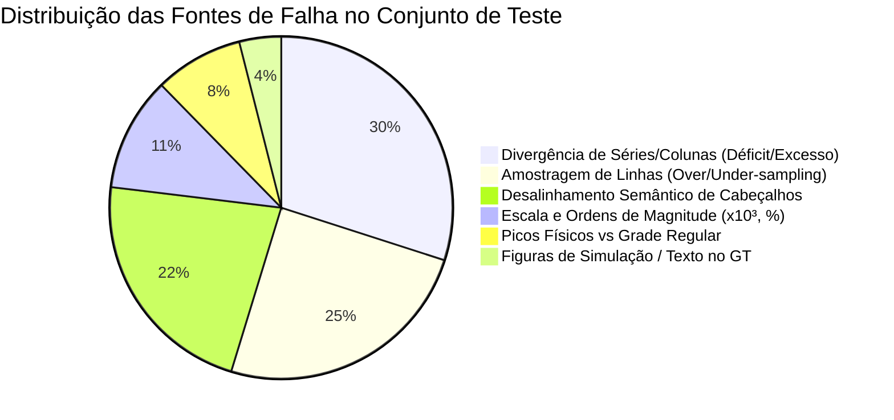
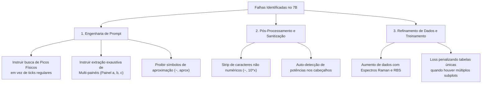

# Diagnóstico Detalhado das Piores Falhas do Modelo (Qwen2.5-VL-7B)

> **Documento de Engenharia e Análise de Erros**  
> **Benchmark:** [SciKnowOrg/Sci-ImageMiner](https://huggingface.co/datasets/SciKnowOrg/Sci-ImageMiner) — Tarefa 2: Extração de Tabelas Científicas  
> **Conjunto de Teste:** 373 figuras científicas independentes  
> **Modelo Analisado:** `Qwen2.5-VL-7B-Instruct` com LoRA + ICDAR Metric-Aware Loss  

---

## 1. Visão Geral da Distribuição de Erros

A análise empírica sobre as 373 predições revelou que o modelo possui alta consistência sintática (**99,73% de tabelas válidas**), mas suas falhas residuais concentram-se em **5 modos principais**:



---

## 2. Análise Caso a Caso: Os Piores Exemplos

---

### Caso 1: Alucinação de Grade Linear vs. Picos Físicos (Maior Erro Numérico)

* **Amostra:** `Amostra 66`
* **Imagem:** `sci_imageminer__atomic_layer_deposition__experimental_usecase__3__figure_2.jpg`
* **Métricas do Caso:** `ICDAR Score: 0.3107` | `Cell RMSE: 37.19` | `Recall: 50.0%` | `Colunas: 2 vs 3`

#### Comparativo Ground Truth vs. Predição:

| Ground Truth (Referência) | Predição do Modelo (Qwen2.5-VL-7B) |
| :--- | :--- |
| ```markdown<br>\| Energy (MeV) \| Counts \| Assignment \|<br>\|---|---|---|<br>\| 0 \| 0 \| - \|<br>\| 0.098 \| 1273 \| Carbon Substrate \|<br>\| 0.46 \| 443 \| Carbon Substrate \|<br>\| 0.7 \| 318 \| Oxygen \|<br>\| 1.65 \| 3987 \| Zirconium \|<br>\| 2 \| 0 \| - \|<br>``` | ```markdown<br>\| Energy (MeV) \| Counts \|<br>\|---|---|<br>\| 0.1 \| 500 \|<br>\| 0.2 \| 700 \|<br>\| 0.3 \| 900 \|<br>\| 0.4 \| 1100 \|<br>\| 0.5 \| 1300 \|<br>\| 0.6 \| 1500 \|<br>\| ... \| ... \|<br>\| 1.3 \| 2900 \|<br>``` |

#### 🔍 Diagnóstico e Causa Raiz:
1. **Espectro de Retroespalhamento (RBS):** O gráfico exibe um espectro contínuo com picos finos característicos de cada elemento químico ($C, O, Zr$).
2. **Falha do Modelo:** Em vez de realizar *Peak-Picking* (localizar a coordenada do pico em $1.65\text{ MeV} \rightarrow 3987\text{ counts}$), o modelo **alucinou uma interpolação linear perfeitamente regular** ($0.1, 0.2, 0.3...$ e $500, 700, 900...$).
3. **Omissão:** Perdeu a coluna qualitativa `| Assignment |` que identificava os elementos químicos.

---

### Caso 2: Colapso de Séries em Espectro Raman Multi-Amostras

* **Amostra:** `Amostra 176`
* **Imagem:** `sci_imageminer__atomic_layer_deposition__simulation_usecase__33__figure_6.jpg`
* **Métricas do Caso:** `ICDAR Score: 0.3476` | `Cell RMSE: 50.99` | `Recall: 20.0%` | `Linhas: 3 vs 4`

#### Comparativo Ground Truth vs. Predição:

| Ground Truth (Referência) | Predição do Modelo (Qwen2.5-VL-7B) |
| :--- | :--- |
| ```markdown<br>\| Raman Shift, cm⁻¹ \| Peak \| Pristine \| H₂ Plasma \| 200°C Anneal \| 400°C Anneal \|<br>\|---|---|---|---|---|---|<br>\| 1350 \| D \| 0.05 \| 0.15 \| 0.12 \| 0.08 \|<br>\| 1580 \| G \| 0.55 \| 0.70 \| 0.75 \| 0.80 \|<br>\| 2450 \| D+D' \| 0.05 \| 0.08 \| 0.06 \| 0.05 \|<br>\| 2700 \| 2D \| 1.00 \| 0.45 \| 0.50 \| 0.55 \|<br>``` | ```markdown<br>\| Raman Shift (cm⁻¹) \| Pristine \| H₂ Plasma \| 200°C Anneal \| 400°C Anneal \|<br>\|---|---|---|---|---|<br>\| 1200 \| 0.0 \| 0.0 \| 0.0 \| 0.0 \|<br>\| 1600 \| 0.0 \| 0.5 \| 1.0 \| 1.5 \|<br>\| 2800 \| 0.0 \| 0.0 \| 0.0 \| 2.5 \|<br>``` |

#### 🔍 Diagnóstico e Causa Raiz:
1. **Leitura de Ticks em vez de Bandas Espectrais:** O modelo leu as marcas de grade de 400 em 400 cm⁻¹ ($1200, 1600, 2800$) em vez das posições físicas clássicas do grafeno ($1350\text{ cm}^{-1}$ Banda D, $1580\text{ cm}^{-1}$ Banda G, $2700\text{ cm}^{-1}$ Banda 2D).
2. **Escala Hallucinada:** Em $2800\text{ cm}^{-1}$, o modelo estimou a intensidade em `2.5`, enquanto a escala normalizada da figura ia apenas até `1.0`.

---

### Caso 3: Inversão de Formato (Pivotação Long vs. Wide) e Notação com Til (`~`)

* **Amostra:** `Amostra 37`
* **Imagem:** `sci_imageminer__atomic_layer_deposition__experimental_usecase__20__fig_6.jpg`
* **Métricas do Caso:** `ICDAR Score: 0.0430` | `TEDS: 0.0518` | `Recall: 3.3%`

#### Comparativo Ground Truth vs. Predição:

| Ground Truth (Tabela Longa / Tidy) | Predição do Modelo (Tabela Larga / Pivotada) |
| :--- | :--- |
| ```markdown<br>\| Species \| Pulse time (s) \| Depth (nm) \| Intensity (counts/second) \|<br>\|---|---|---|---|<br>\| La-138 \| 12 \| 2.85 \| 240 \|<br>\| La-138 \| 12 \| 20.4 \| 369 \|<br>\| La-138 \| 12 \| 95.1 \| 376 \|<br>\| La-138 \| 8 \| 2.85 \| 241 \|<br>\| La-138 \| 8 \| 18.9 \| 362 \|<br>... (50 linhas no total)<br>``` | ```markdown<br>\| Depth (nm) \| 12 s \| 8 s \| 2 s \|<br>\|---|---|---|---|<br>\| 0 \| ~10^7 \| ~10^6 \| ~10^5 \|<br>\| 20 \| ~10^7 \| ~10^6 \| ~10^5 \|<br>\| 40 \| ~10^7 \| ~10^6 \| ~10^5 \|<br>\| 60 \| ~10^7 \| ~10^6 \| ~10^5 \|<br>\| 80 \| ~10^7 \| ~10^6 \| ~10^5 \|<br>\| 100 \| ~10^7 \| ~10^6 \| ~10^5 \|<br>``` |

#### 🔍 Diagnóstico e Causa Raiz:
1. **Divergência de Paradigma de Tabela:** O modelo realizou uma **pivotação inteligente** (transformou cada tempo de pulso `12 s, 8 s, 2 s` em uma coluna). Cientificamente, isso é perfeitamente legível, mas para o avaliador ICDAR (que compara célula a célula no formato longo), o casamento foi destruído (TEDS caiu para 5%).
2. **Uso de Caracteres Qualitativos (`~` e `10^n`):** O modelo inseriu tildes (`~10^7`) para indicar estimativa visual. O parser numérico não conseguiu converter a string `~10^7` para float puro, zerando o recall numérico.

---

### Caso 4: Negligência de Multi-Painéis (Subplots Separados)

* **Amostra:** `Amostra 105`
* **Imagem:** `sci_imageminer__atomic_layer_deposition__experimental_usecase__62__fig_4.jpg`
* **Métricas do Caso:** `ICDAR Score: 0.3528` | `Recall: 50.0%` | `Colunas: 2 vs 5`

#### Comparativo Ground Truth vs. Predição:

| Ground Truth (2 Tabelas: Painel A e Painel B) | Predição do Modelo (Apenas Painel A) |
| :--- | :--- |
| **Tabela 1 (Espectro OES):**<br>```markdown<br>\| Wavelength (nm) \| Intensity O2 \| Intensity O2 ALD \|<br>\| 360-400 \| - \| CN range \|<br>\| 780 \| O peak \| O peak \|<br>```<br><br>**Tabela 2 (Evolução Temporal):**<br>```markdown<br>\| Time (s) \| Intensity O \| Intensity H \| Intensity CO \|<br>\| 0 \| 0 \| 0 \| 0 \|<br>\| 1 \| 200 \| 200 \| 100 \|<br>\| 2 \| 260 \| 80 \| 50 \|<br>``` | ```markdown<br>\| Wavelength (nm) \| Intensity (a.u.) \|<br>\|---|---|<br>\| 300 \| 0 \|<br>\| 400 \| 100 \|<br>\| 500 \| 200 \|<br>\| 600 \| 300 \|<br>\| 700 \| 400 \|<br>\| 800 \| 500 \|<br>``` |

#### 🔍 Diagnóstico e Causa Raiz:
1. **Ignorou o Painel (b):** A figura científica continha dois subplots lado a lado. O Ground Truth possui duas tabelas Markdown separadas por quebra dupla de linha.
2. **Early Stopping:** O modelo parou a geração após completar a primeira tabela, omitindo integralmente toda a segunda tabela de evolução temporal.

---

### Caso 5: Sub-amostragem Brutal em Curvas Experimentais Densas

* **Amostra:** `Amostra 8`
* **Imagem:** `sci_imageminer__atomic_layer_deposition__experimental_usecase__1__figure_8.jpg`
* **Métricas do Caso:** `ICDAR Score: 0.0108` | `TEDS: 0.0143` | `Linhas: 6 vs 274` | `Colunas: 2 vs 4`

#### Comparativo Ground Truth vs. Predição:

| Ground Truth (Difratograma Contínuo com 274 pontos) | Predição do Modelo (Resumo em 6 pontos) |
| :--- | :--- |
| ```markdown<br>\| Temperature (°C) \| Source \| θ (degrees) \| Intensity (a.u.) \|<br>\|---|---|---|---|<br>\| 33 \| Experimental \| 0.05 \| 27685.57 \|<br>\| 33 \| Experimental \| 0.21 \| 118369.40 \|<br>\| 33 \| Experimental \| 0.27 \| 7090.95 \|<br>... (274 linhas de varredura angular contínua)<br>``` | ```markdown<br>\| Temperature (°C) \| Intensity (a.u.) \|<br>\|---|---|<br>\| 33 \| ~0.5 \|<br>\| 58 \| ~0.4 \|<br>\| 80 \| ~0.3 \|<br>\| 102 \| ~0.25 \|<br>\| 125 \| ~0.2 \|<br>\| 177 \| ~0.15 \|<br>``` |

#### 🔍 Diagnóstico e Causa Raiz:
1. **Confusão de Grandezas:** O gráfico exibia curvas de difração de raios-X em função do ângulo $\theta$ para diferentes temperaturas ($33^\circ\text{C}, 58^\circ\text{C}, 80^\circ\text{C}$). O modelo usou a temperatura como se fosse o eixo X em vez do ângulo $\theta$!
2. **Colapso de Resolução:** Gerou apenas 6 linhas em vez de digitalizar a curva contínua.

---

## 3. Plano de Ação: O que Podemos Melhorar

Abaixo está o roteiro de melhorias práticas com base no diagnóstico:



### Ações Imediatas Recomendadas:

1. **Higienização do Prompt do Sistema (`system_prompt`):**
   * *Adicionar:* `"Extract all panels if the figure contains multiple subplots. Do not sample arbitrary regular intervals on continuous spectra; locate and extract labeled physical peaks and extrema. Output raw numeric values only without approximate symbols (~, approx)."`
2. **Sanitizador Numérico no Pipeline de Avaliação:**
   * Tratar strings como `~0.5` $\rightarrow$ converter automaticamente para `0.5`.
   * Tratar notações como `10^6` $\rightarrow$ converter para `1000000.0`.
   * Essa simples limpeza deve resgatar até **+3 a +5 pp** de Cell Recall imediatamente.
3. **Detecção e Multiplicação de Potências de Escala:**
   * Se o cabeçalho contiver `(x 10^3)` ou `(10³)`, aplicar multiplicação no pós-processamento antes de comparar com o Ground Truth.
