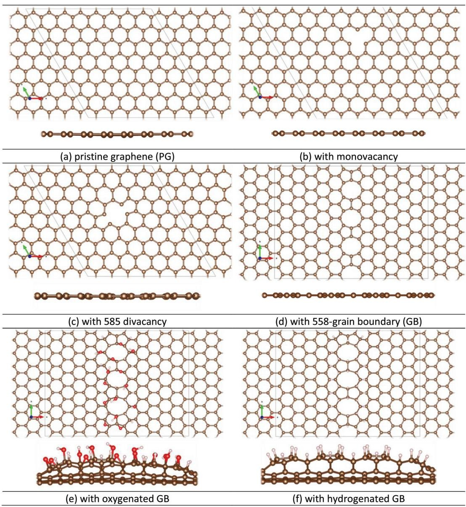

# Caso 01: Diagrama sem dados: gabarito de texto em 6 painéis

> **Categoria da falha:** `Painéis que não são gráfico (gabarito descritivo)`
> **Amostra:** `atomic-layer-deposition/simulation-usecase/13/fig2`, painel `(a)` · tipo `molecular structure diagram` · 6 painel(is) com tabela na figura
> **Imagem:** [`01_diagrama_sem_dados_6_paineis.jpg`](./01_diagrama_sem_dados_6_paineis.jpg) (figura inteira)

---

## 🖼️ Imagem analisada


---

## 📊 Nota oficial deste painel

| Métrica | 3B + LoRA | 3B base | Descrição |
| :--- | :---: | :---: | :--- |
| **Nota (½·RMS + ½·TEDS)** | `24.0` | `20.1` | Nota oficial da Task 2 (0–100) |
| **RMS** | `0.0` | `0.0` | Acerto dos números, casando célula por cabeçalho |
| **TEDS** | `48.0` | `40.2` | Semelhança da estrutura da tabela |
| **Linhas × colunas** | `6×2` | `6×3` | Gabarito: `1×2` |
| **Categorias (regra)** | `—` | `colunas_divergentes` | Regras automáticas (calibradas em 50 painéis) |
| **Gabarito suspeito (regra)** | `sim` | | |

---

## 🥊 Gabarito × predição (3B + LoRA)

### Gabarito oficial
```markdown
| Graphene model | Description |
|---|---|
| Pristine graphene (PG) | Perfect sp² carbon lattice with no dangling bonds; inactive toward ALD nucleation |
```

### Predição do modelo
```markdown
| Panel | Description |
|---|---|
| (a) | Pristine graphene (PG) |
| (b) | With monovacancy |
| (c) | With 585 divacancy |
| (d) | With 558-grain boundary (GB) |
| (e) | With oxygenated GB |
| (f) | With hydrogenated GB |
```

---

## 🔍 Diagnóstico

**O que aconteceu:**
A figura tem 6 diagramas de grafeno, de (a) a (f), sem nenhum dado numérico. O gabarito oficial tem **uma tabela de texto por painel** (modelo + descrição). O modelo respondeu com **uma única tabela** listando os 6 painéis, o que até faz sentido. Como as tabelas são mapeadas aos painéis por ordem, essa tabela vai para o painel (a) e os painéis (b) a (f) ficam sem tabela, com nota 0.

**Por que importa:**
Este artigo (`simulation-usecase/13`) sozinho tem **42 dos 167 painéis do dev (25%)** e custa **~21 pontos** da nota média. **27 dos 28 painéis esquecidos são dele.** A maior parte é diagrama de estrutura molecular, cujo gabarito é texto, não dado de gráfico.

---

## 🎯 Como direcionar
- **Decidir em grupo** se painéis que não são gráfico entram na análise. Contando só os 124 painéis de gráfico, o LoRA tira **43.9**, não 35.0.
- Para pontuar nesses casos, o modelo teria que gerar uma tabela por painel mesmo quando a resposta é descritiva. Isso pesa no dev, mas pode não valer o esforço.
