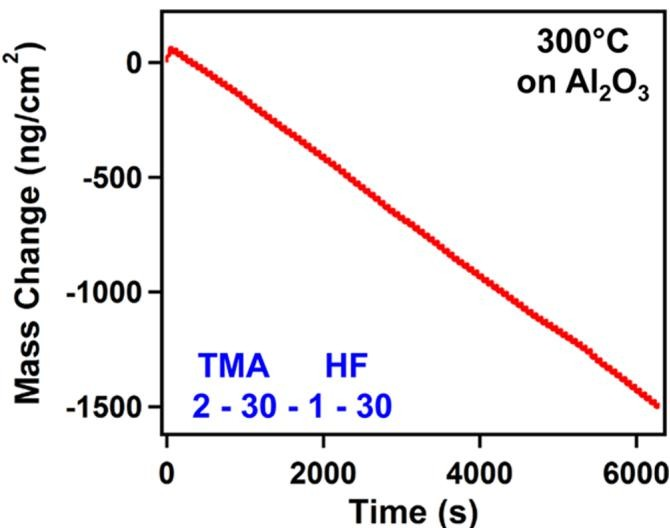

# Caso 02: Tendência invertida

> **Categoria da falha:** `Curva lida de trás para frente`
> **Amostra:** `atomic-layer-etching/experimental-usecase/24/figure_1`, painel `(a)` · tipo `line chart` · 1 painel(is) com tabela na figura
> **Imagem:** [`02_tendencia_invertida.jpg`](./02_tendencia_invertida.jpg) (recorte do painel (a) pelo bbox oficial)

---

## 🖼️ Imagem analisada


---

## 📊 Nota oficial deste painel

| Métrica | 3B + LoRA | 3B base | Descrição |
| :--- | :---: | :---: | :--- |
| **Nota (½·RMS + ½·TEDS)** | `27.5` | `35.8` | Nota oficial da Task 2 (0–100) |
| **RMS** | `0.0` | `9.6` | Acerto dos números, casando célula por cabeçalho |
| **TEDS** | `55.0` | `62.1` | Semelhança da estrutura da tabela |
| **Linhas × colunas** | `4×2` | `6×2` | Gabarito: `13×2` |
| **Categorias (regra)** | `amostragem_linhas` | `amostragem_linhas` | Regras automáticas, **ainda não calibradas** |
| **Gabarito suspeito (regra)** | `não` | | |

---

## 🥊 Gabarito × predição (3B + LoRA)

### Gabarito oficial
```markdown
| Time (s) | Mass Change (ng/cm²) |
|---|---|
| 0 | 0 |
| 500 | -125 |
| 1000 | -250 |
| 1500 | -375 |
| 2000 | -500 |
| 2500 | -625 |
| 3000 | -750 |
| 3500 | -875 |
| 4000 | -1000 |
| 4500 | -1125 |
| 5000 | -1250 |
| 5500 | -1375 |
| 6000 | -1500 |
```

### Predição do modelo
```markdown
| Time (s) | Mass Change (ng/cm²) |
|----------|----------------------|
| 0        | -1500                |
| 2000     | -1000                |
| 4000     | -750                 |
| 6000     | -500                 |
```

---

## 🔍 Diagnóstico

**O que aconteceu:**
A massa **cai** quase em linha reta de ~0 para ~−1500 ng/cm² ao longo de 6000 s. O gabarito acompanha essa reta em 13 pontos. A predição tem só 4 pontos e **começa em −1500 e sobe até −500**, ou seja, o sentido da curva está invertido.

**Por que importa:**
A regra marcou só `amostragem_linhas` (4 linhas contra 13), mas o erro que zera o RMS é a direção. **Nenhuma regra atual pega 'tendência invertida'.**

---

## 🎯 Como direcionar
- Candidata a regra nova: correlação negativa entre a coluna Y prevista e a do gabarito.
- Dados sintéticos com curvas decrescentes e eixos com valores negativos.
