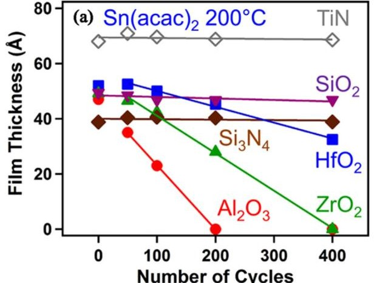

# Caso 03: Várias séries espremidas numa célula

> **Categoria da falha:** `Estrutura: legenda virou texto dentro da célula`
> **Amostra:** `atomic-layer-etching/experimental-usecase/19/fig_5`, painel `(a)` · tipo `multiple line chart` · 2 painel(is) com tabela na figura
> **Imagem:** [`03_series_numa_celula.jpg`](./03_series_numa_celula.jpg) (recorte do painel (a) pelo bbox oficial)

---

## 🖼️ Imagem analisada


---

## 📊 Nota oficial deste painel

| Métrica | 3B + LoRA | 3B base | Descrição |
| :--- | :---: | :---: | :--- |
| **Nota (½·RMS + ½·TEDS)** | `21.2` | `15.0` | Nota oficial da Task 2 (0–100) |
| **RMS** | `0.0` | `0.0` | Acerto dos números, casando célula por cabeçalho |
| **TEDS** | `42.3` | `30.1` | Semelhança da estrutura da tabela |
| **Linhas × colunas** | `4×2` | `2×2` | Gabarito: `5×7` |
| **Categorias (regra)** | `colunas_divergentes` | `colunas_divergentes;amostragem_linhas` | Regras automáticas (calibradas em 50 painéis) |
| **Gabarito suspeito (regra)** | `não` | | |

---

## 🥊 Gabarito × predição (3B + LoRA)

### Gabarito oficial
```markdown
| Number of Cycles | TiN (Å) | SiO2 (Å) | HfO2 (Å) | Si3N4 (Å) | ZrO2 (Å) | Al2O3 (Å) |
|---|---|---|---|---|---|---|
| 0 | 68 | 49 | 52 | 39 | 48 | 47 |
| 50 | 70 | 48 | 52 | 40 | 47 | 35 |
| 100 | 69 | 47 | 50 | 40 | 42 | 23 |
| 200 | 69 | 47 | 45 | 40 | 28 | 0 |
| 400 | 69 | 46 | 33 | 39 | 0 | - |
```

### Predição do modelo
```markdown
| Number of Cycles | Film Thickness (Å) |
|---|---|
| 0 | Sn(acac)_2: 65, TiN: 70, SiO_2: 45, Si_3N_4: 40, Al_2O_3: 15, ZrO_2: 5 |
| 100 | Sn(acac)_2: 65, TiN: 70, SiO_2: 45, Si_3N_4: 40, Al_2O_3: 15, ZrO_2: 5 |
| 200 | Sn(acac)_2: 65, TiN: 70, SiO_2: 45, Si_3N_4: 40, Al_2O_3: 15, ZrO_2: 5 |
| 400 | Sn(acac)_2: 65, TiN: 70, SiO_2: 45, Si_3N_4: 40, Al_2O_3: 15, ZrO_2: 5 |
```

---

## 🔍 Diagnóstico

**O que aconteceu:**
O gráfico tem 6 materiais (TiN, SiO₂, HfO₂, Si₃N₄, ZrO₂, Al₂O₃), cada um com uma curva. O gabarito põe **uma coluna por material**. A predição usa 2 colunas e escreve `TiN: 70, SiO_2: 45, ...` **dentro de uma célula**, repete os mesmos valores em todas as linhas e trata o título `Sn(acac)₂ 200°C`, que é o precursor, como se fosse uma série.

**Por que importa:**
Como a célula não é um número, o RMS dá 0. O padrão aparece em 3 painéis do LoRA (nota média 21.9) e em nenhum do base, então foi introduzido pelo fine-tune, embora raro.

---

## 🎯 Como direcionar
- Prompt: "uma coluna por série da legenda; nunca liste várias séries numa célula".
- A regra `colunas_divergentes` já pega o caso; vale uma regra específica se o padrão crescer.
