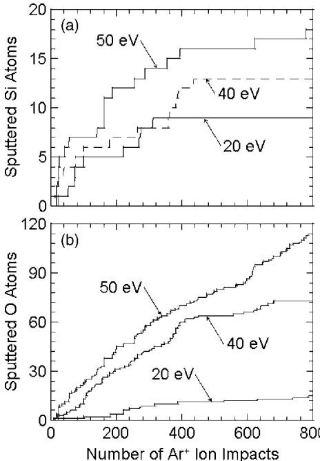

# Caso 04: Rampa inventada no lugar de patamares (e bbox trocado no metadata)

> **Categoria da falha:** `Linearização de curva em degraus`
> **Amostra:** `atomic-layer-etching/simulation-usecase/1/fig_6`, painel `(a)` · tipo `multiple line chart` · 2 painel(is) com tabela na figura
> **Imagem:** [`04_rampa_inventada_bbox_trocado.jpg`](./04_rampa_inventada_bbox_trocado.jpg) (figura inteira)

---

## 🖼️ Imagem analisada


---

## 📊 Nota oficial deste painel

| Métrica | 3B + LoRA | 3B base | Descrição |
| :--- | :---: | :---: | :--- |
| **Nota (½·RMS + ½·TEDS)** | `39.1` | `35.2` | Nota oficial da Task 2 (0–100) |
| **RMS** | `4.0` | `3.7` | Acerto dos números, casando célula por cabeçalho |
| **TEDS** | `74.3` | `66.7` | Semelhança da estrutura da tabela |
| **Linhas × colunas** | `8×4` | `9×2` | Gabarito: `10×4` |
| **Categorias (regra)** | `grade_regular_inventada` | `colunas_divergentes;grade_regular_inventada` | Regras automáticas (calibradas em 50 painéis) |
| **Gabarito suspeito (regra)** | `não` | | |

---

## 🥊 Gabarito × predição (3B + LoRA)

### Gabarito oficial
```markdown
| Number of Ar+ Ion Impacts | 20 eV (Sputtered Si Atoms) | 40 eV (Sputtered Si Atoms) | 50 eV (Sputtered Si Atoms) |
|---|---|---|---|
| 0 | 0 | 0 | 0 |
| 50 | 2 | 4 | 7 |
| 100 | 4 | 6 | 8 |
| 200 | 5 | 7 | 12 |
| 300 | 9 | 8 | 14 |
| 400 | 9 | 13 | 16 |
| 500 | 9 | 13 | 16 |
| 600 | 9 | 13 | 16 |
| 700 | 9 | 13 | 17 |
| 800 | 9 | 13 | 18 |
```

### Predição do modelo
```markdown
| Number of Ar+ Ion Impacts | Sputtered Si Atoms (20 eV) | Sputtered Si Atoms (40 eV) | Sputtered Si Atoms (50 eV) |
|---|---|---|---|
| 0 | 0 | 0 | 0 |
| 100 | 3 | 6 | 8 |
| 200 | 7 | 10 | 13 |
| 300 | 10 | 14 | 17 |
| 400 | 13 | 17 | 20 |
| 500 | 16 | 19 | 22 |
| 600 | 18 | 21 | 24 |
| 700 | 20 | 23 | 26 |
```

---

## 🔍 Diagnóstico

**O que aconteceu:**
O painel (a), Sputtered Si Atoms, tem curvas **em degraus que estabilizam**: 20 eV fica em ~9 a partir de ~300 impactos, e o eixo vai até 20. O gabarito acompanha os patamares. A predição cresce de forma suave e contínua até **20, 23 e 26**, passando do máximo do eixo, com o X de 100 em 100.

**Por que importa:**
A regra marcou `grade_regular_inventada`, que é o mesmo padrão do 'Alucinação de Grade Dummy' do diagnóstico do 7B. **Observação:** no metadata oficial, os `bbox` dos painéis (a) e (b) estão trocados: o de (a) aponta para o gráfico de baixo, marcado (b). Isso não muda a nota, porque o modelo vê a figura inteira, mas engana quem recorta por bbox, como o nosso notebook.

---

## 🎯 Como direcionar
- Dados sintéticos com curvas em degrau e com platô.
- Avisar quem usar bbox para recortar painéis: conferir a letra no recorte.
