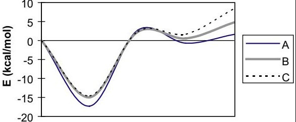

# Caso 05: Eixo X sem rótulos (perfil de energia de reação)

> **Categoria da falha:** `Linhas da tabela vieram dos ticks do eixo Y`
> **Amostra:** `atomic-layer-deposition/simulation-usecase/24/fig_8`, painel `(a)` · tipo `multiple line chart` · 1 painel(is) com tabela na figura
> **Imagem:** [`05_eixo_categorico_sem_rotulo.jpg`](./05_eixo_categorico_sem_rotulo.jpg) (recorte do painel (a) pelo bbox oficial)

---

## 🖼️ Imagem analisada


---

## 📊 Nota oficial deste painel

| Métrica | 3B + LoRA | 3B base | Descrição |
| :--- | :---: | :---: | :--- |
| **Nota (½·RMS + ½·TEDS)** | `33.9` | `30.7` | Nota oficial da Task 2 (0–100) |
| **RMS** | `0.0` | `0.0` | Acerto dos números, casando célula por cabeçalho |
| **TEDS** | `67.9` | `61.3` | Semelhança da estrutura da tabela |
| **Linhas × colunas** | `5×4` | `7×4` | Gabarito: `5×4` |
| **Categorias (regra)** | `cabecalho_desalinhado` | `cabecalho_desalinhado;grade_regular_inventada` | Regras automáticas, **ainda não calibradas** |
| **Gabarito suspeito (regra)** | `não` | | |

---

## 🥊 Gabarito × predição (3B + LoRA)

### Gabarito oficial
```markdown
| Reaction Step | ΔE (kcal/mol) A |ΔE (kcal/mol) B |ΔE (kcal/mol) C |
|---|---|---|---|
| Start | 0 |0 |0 |
| Complex | -17|-15|-15|
| TS |3|3|3|
| HCl (a) | -1| 0|2|
| HCl (g)| 2| 5|8|
```

### Predição do modelo
```markdown
| E (kcal/mol) | A | B | C |
|---|---|---|---|
| -20 | -15 | -15 | -15 |
| -10 | -8 | -8 | -8 |
| 0 | -4 | -4 | -4 |
| 5 | 3 | 3 | 3 |
| 10 | 2 | 2 | 2 |
```

---

## 🔍 Diagnóstico

**O que aconteceu:**
O gráfico mostra a energia de 3 caminhos de reação (A, B, C), e **o eixo X não tem marcações**. O gabarito usa as etapas `Start, Complex, TS, HCl(a), HCl(g)`, nomes que **não aparecem na imagem** (vêm do artigo), e os valores batem com o gráfico (mínimo de −17 em A). A predição usou os ticks do eixo Y (−20, −10, 0, 5, 10) como linhas, e a estrutura fica sem sentido.

**Por que importa:**
A regra marcou `cabecalho_desalinhado`. O gabarito depende de informação de fora da imagem, então só a figura não basta.

---

## 🎯 Como direcionar
- Passar a **legenda da figura (caption)** no prompt. O prompt oficial permite, e o DocMiner e o VLMinators fizeram isso.
