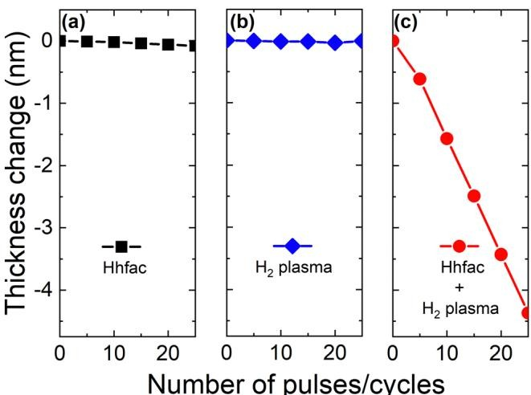

# Caso 06: Valor constante, gabarito errado e regra errada

> **Categoria da falha:** `Três erros no mesmo painel`
> **Amostra:** `atomic-layer-etching/experimental-usecase/10/fig_6`, painel `(c)` · tipo `line chart` · 3 painel(is) com tabela na figura
> **Imagem:** [`06_valor_constante_gabarito_errado.jpg`](./06_valor_constante_gabarito_errado.jpg) (figura inteira)

---

## 🖼️ Imagem analisada


---

## 📊 Nota oficial deste painel

| Métrica | 3B + LoRA | 3B base | Descrição |
| :--- | :---: | :---: | :--- |
| **Nota (½·RMS + ½·TEDS)** | `47.2` | `56.5` | Nota oficial da Task 2 (0–100) |
| **RMS** | `0.0` | `18.0` | Acerto dos números, casando célula por cabeçalho |
| **TEDS** | `94.4` | `95.0` | Semelhança da estrutura da tabela |
| **Linhas × colunas** | `5×2` | `5×2` | Gabarito: `5×2` |
| **Categorias (regra)** | `escala_magnitude` | `—` | Regras automáticas, **ainda não calibradas** |
| **Gabarito suspeito (regra)** | `não` | | |

---

## 🥊 Gabarito × predição (3B + LoRA)

### Gabarito oficial
```markdown
| Number of pulses/cycles | Thickness change (nm) |
|--------------------------|------------------------|
| 0                        | 0                      |
| 5                        | -0.5                   |
| 10                       | -1.0                   |
| 15                       | -1.5                   |
| 20                       | -2.0                   |
```

### Predição do modelo
```markdown
| Number of pulses/cycles | Thickness change (nm) |
|---|---|
| 0 | -0.1 |
| 5 | -0.1 |
| 10 | -0.1 |
| 15 | -0.1 |
| 20 | -0.1 |
```

---

## 🔍 Diagnóstico

**O que aconteceu:**
No painel (c), a espessura cai de 0 para **~−4.4 nm** em 25 ciclos (eixo Y compartilhado à esquerda). O **gabarito está errado**: vai só até −2.0, com metade da inclinação, e não tem o ponto de 25 ciclos. A **predição também está errada**: dá −0.1 em todas as linhas, como se copiasse os painéis (a) e (b), que são quase planos.

**Por que importa:**
A regra marcou `escala_magnitude`, porque a razão previsto/gabarito ≈ 0.08, perto de 10⁻¹. **Não é erro de escala, é valor constante.** É um falso positivo, e mostra por que as regras precisam ser calibradas com a revisão manual antes de virar número final.

---

## 🎯 Como direcionar
- Calibração: exigir que a razão seja estável entre as linhas antes de chamar de erro de escala.
- Levar como exemplo de gabarito com erro numérico, não só de formato.
