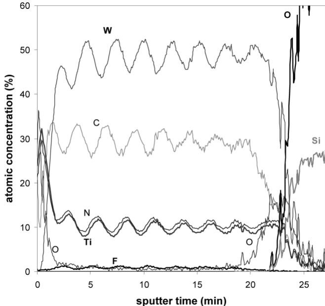

# Caso 07: Gabarito com aproximações e texto

> **Categoria da falha:** `Gabarito suspeito`
> **Amostra:** `atomic-layer-deposition/experimental-usecase/11/fig_8`, painel `(a)` · tipo `multi spectra chart` · 1 painel(is) com tabela na figura
> **Imagem:** [`07_gabarito_com_aproximacoes.jpg`](./07_gabarito_com_aproximacoes.jpg) (recorte do painel (a) pelo bbox oficial)

---

## 🖼️ Imagem analisada


---

## 📊 Nota oficial deste painel

| Métrica | 3B + LoRA | 3B base | Descrição |
| :--- | :---: | :---: | :--- |
| **Nota (½·RMS + ½·TEDS)** | `23.2` | `0.0` | Nota oficial da Task 2 (0–100) |
| **RMS** | `0.0` | `0.0` | Acerto dos números, casando célula por cabeçalho |
| **TEDS** | `46.5` | `0.0` | Semelhança da estrutura da tabela |
| **Linhas × colunas** | `6×2` | `0×0` | Gabarito: `6×8` |
| **Categorias (regra)** | `colunas_divergentes` | `painel_faltando` | Regras automáticas (calibradas em 50 painéis) |
| **Gabarito suspeito (regra)** | `sim` | | |

---

## 🥊 Gabarito × predição (3B + LoRA)

### Gabarito oficial
```markdown
| Sputter Time (min)|W (%)|C (%)|N (%)|Ti (%)|O (%)|F (%)|Si (%)|
|-------------------|-----|-----|-----|------|-----|-----|------|
|0|~10|~15|~8|~5|~2|~0.5|~0|
|5|~48|~30|~10|~6|~1|~0.3|~0|
|10|~52|~32|~11|~7|~1|~0.3|~0|
|15|~50|~30|~10|~6|~1|~0.2|~0|
|20|~45|~25|~9|~5|~1|~0.2|~0|
|25|~2|~5|~3|~1|~10–50 rising|~0.2|sharply rising|
```

### Predição do modelo
```markdown
| sputter time (min) | atomic concentration (%) |
|---|---|
| 0 | W: 35, C: 32, N: 10, Ti: 0, O: 0, F: 0 |
| 5 | W: 45, C: 35, N: 10, Ti: 0, O: 0, F: 0 |
| 10 | W: 50, C: 35, N: 10, Ti: 0, O: 0, F: 0 |
| 15 | W: 50, C: 35, N: 10, Ti: 0, O: 0, F: 0 |
| 20 | W: 50, C: 35, N: 10, Ti: 0, O: 0, F: 0 |
| 25 | W: 50, C: 35, N: 10, Ti: 0, O: 0, F: 0 |
```

---

## 🔍 Diagnóstico

**O que aconteceu:**
O gráfico é um perfil de composição com 8 elementos. **Todo o gabarito usa `~`** (`~10`, `~48`), e a última linha tem `~10–50 rising` e `sharply rising`. A predição também é ruim: espreme as séries numa célula (como no caso 03) e repete os valores a partir de 10 min.

**Por que importa:**
O RMS oficial tenta ler cada célula como número. Com `~`, falha e compara como texto. **Nem uma predição perfeita pontua bem aqui.** Casos assim pesam na nota sem dizer nada sobre o modelo.

---

## 🎯 Como direcionar
- Contar esses casos à parte (`gt_suspeito`) e levar o número ao André, como o Lucas sugeriu.
- A regra automática só pega esse tipo de erro de formato. Na revisão de 50 painéis, 20 dos 25 escolhidos ao acaso tinham gabarito com valor ou eixo errado.
