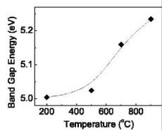

# Caso 08: Métrica generosa: curva errada com nota 97

> **Categoria da falha:** `Limite da métrica oficial`
> **Amostra:** `atomic-layer-deposition/experimental-usecase/17/fig_8`, painel `(b)` · tipo `scatter plot` · 2 painel(is) com tabela na figura
> **Imagem:** [`08_metrica_generosa.jpg`](./08_metrica_generosa.jpg) (recorte do painel (b) pelo bbox oficial)

---

## 🖼️ Imagem analisada


---

## 📊 Nota oficial deste painel

| Métrica | 3B + LoRA | 3B base | Descrição |
| :--- | :---: | :---: | :--- |
| **Nota (½·RMS + ½·TEDS)** | `97.3` | `84.5` | Nota oficial da Task 2 (0–100) |
| **RMS** | `96.9` | `72.1` | Acerto dos números, casando célula por cabeçalho |
| **TEDS** | `97.8` | `97.0` | Semelhança da estrutura da tabela |
| **Linhas × colunas** | `4×2` | `4×2` | Gabarito: `4×2` |
| **Categorias (regra)** | `—` | `—` | Regras automáticas, **ainda não calibradas** |
| **Gabarito suspeito (regra)** | `não` | | |

---

## 🥊 Gabarito × predição (3B + LoRA)

### Gabarito oficial
```markdown
| Temperature (°C) | Band Gap Energy (eV) |
|------------------|----------------------|
| 200              | 5.0                  |
| 400              | 5.1                  |
| 600              | 5.2                  |
|800               | 5.26               |
```

### Predição do modelo
```markdown
| Temperature (°C) | Band Gap Energy (eV) |
|---|---|
| 200 | 5.0 |
| 400 | 5.2 |
| 600 | 5.4 |
| 800 | 5.6 |
```

---

## 🔍 Diagnóstico

**O que aconteceu:**
Os 4 pontos estão em ~200, ~500, ~700 e ~900 °C, com band gap de ~5.00, 5.02, 5.16 e 5.23 eV. O **gabarito erra o eixo X** (200, 400, 600, 800). A predição copia esse X e dá **5.0, 5.2, 5.4 e 5.6**, uma curva errada que passa do máximo do eixo (5.25).

**Por que importa:**
Mesmo assim, a nota é **97.3**. O RMS mede o erro **em relação ao valor** (5.6 contra 5.26 é 6%) e aceita até 10%. Em eixos estreitos e longe de zero, como eV ou índice de refração, a métrica não distingue curva certa de errada.

---

## 🎯 Como direcionar
- Ao comparar modelos, olhar também a nota por tipo de gráfico; uma melhora pode vir de casos 'fáceis' para a métrica.
- Bom ponto para discutir com o grupo e o André.
