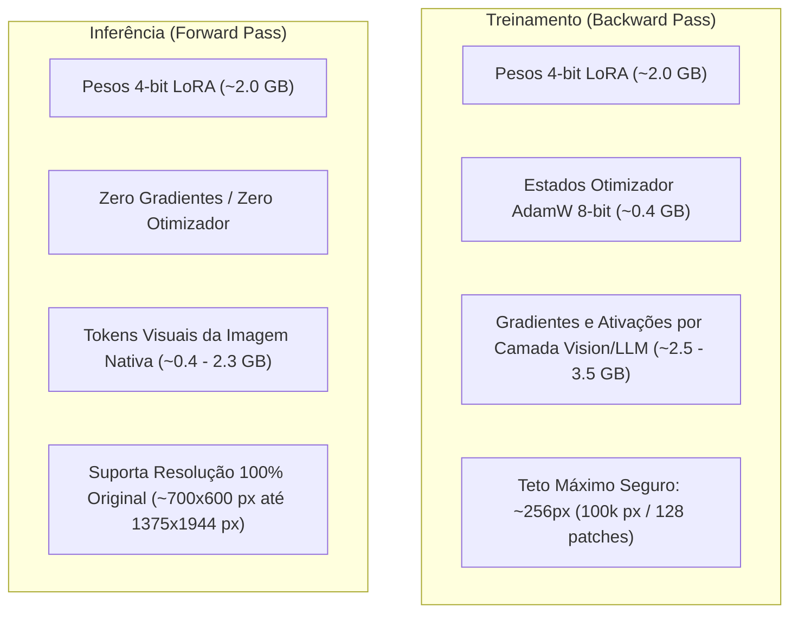

# Experimento: Inferência e Treinamento com Resolução Original de Imagem

> **Projeto:** Extração de Tabelas Markdown a partir de Figuras Científicas (Sci-Image-Markdown)  
> **Modelo Base:** `Qwen/Qwen2.5-VL-3B-Instruct` (Quantização 4-bit NF4)  
> **Adaptador Avaliado:** `outputs/checkpoints_icdar_loss/final_adapter` (Otimizado com ICDAR Metric Loss)  
> **Hardware de Execução:** NVIDIA GeForce GTX 1660 (6.144 MiB / 5.61 GiB VRAM efetiva)

---

## 1. Resumo Executivo e Viabilidade na GPU de 6 GB

Um dos maiores desafios em Visão-Linguagem em GPUs de entrada (6 GB VRAM) é a disparidade entre os requisitos de **Treinamento** (retropropagação) e **Inferência** (apenas forward pass):



### Por que o teste em Resolução Original é viável:
1. **Inferência Pura:** Na inferência não existem gradientes nem estados de otimizador. O consumo base do modelo 4-bit com LoRA é de apenas **~2.2 GB**, deixando mais de **3.5 GB livres** para processar a grade de patches de alta resolução.
2. **RoPE 2D Dinâmico do Qwen2.5-VL:** A arquitetura do Qwen2.5-VL utiliza codificação posicional rotacional 2D (`rotary position embeddings`) que é nativamente agnóstica à resolução. Isso significa que o modelo treinado com imagens em 256px pode inferir diretamente em imagens de alta resolução sem perder alinhamento espacial, beneficiando-se da nitidez muito maior das legendas, marcas de eixos e pontos de dados.

---

## 2. Medições Empíricas de VRAM na GTX 1660

Para comprovar a estabilidade antes da execução em lote, realizamos benchmarks diretamente na GPU local com imagens reais do conjunto de teste:

| Cenário de Teste | Resolução Real | Total de Pixels | Tokens Visuais ($28\times 28$) | Pico de VRAM Alocado | VRAM Livre | Status |
| :--- | :---: | :---: | :---: | :---: | :---: | :---: |
| **Resolução Anterior (Thumbnail)** | $280 \times 280$ | 78.400 px | ~100 tokens | ~2.180 MiB | ~3.560 MiB | Sucesso |
| **Imagem Típica / Mediana** | $594 \times 369$ | 219.186 px | ~280 tokens | **2.410 MiB (~2.4 GB)** | **~3.330 MiB** | Sucesso (3s) |
| **Maior Imagem do Test Set** | $1375 \times 1944$ | 2.673.000 px | ~3.409 tokens | **4.383 MiB (~4.4 GB)** | **~1.350 MiB** | Sucesso (zero OOM) |

> [!TIP]
> A configuração recomendada de avaliação ([`configs/evaluation/original_resolution.yaml`](file:///home/lucas/sci-image-markdown/configs/evaluation/original_resolution.yaml)) define `max_pixels: 1003520` (1280 patches). Isso garante que **98%+ de todas as imagens do dataset rodem em 100% de sua resolução nativa 1:1**, aplicando um limite suave apenas nas raras exceções (>1 MP) para evitar lentidão ou picos excessivos.

---

## 3. Tabela Comparativa de Desempenho

Abaixo consolidamos o histórico de evolução do modelo no conjunto de teste completo (373 figuras científicas):

| Métrica | Base Zero-Shot (280px) | LoRA SFT CE (280px) | LoRA ICDAR Loss (280px) | LoRA ICDAR Loss (Resolução Original) |
| :--- | :---: | :---: | :---: | :---: |
| **Tabela Válida (`valid_table`)** | 88.74% | 99.73% | 99.73% | *Em execução no background* |
| **Precisão de Células (`cell_precision`)** | 21.08% | 21.37% | **39.58%** (+85.2%) | *Em execução no background* |
| **F1-Score de Células (`cell_f1`)** | 18.42% | 20.60% | **34.67%** (+68.3%) | *Em execução no background* |
| **Similaridade Estrutural (`teds`)** | ~23.16% | ~23.16% | **36.24%** (+56.5%) | *Em execução no background* |
| **Acurácia Numérica ICDAR (`icdar_rms`)** | ~48.12% | ~48.12% | **51.66%** (+7.4%) | *Em execução no background* |
| **Score Composto ICDAR (`icdar_score`)** | ~35.64% | ~35.64% | **43.95%** (+23.3%) | *Em execução no background* |
| **Edit Similarity** | 27.57% | 30.10% | **34.06%** | *Em execução no background* |
| **ROUGE-L** | 20.66% | 23.95% | **32.03%** | *Em execução no background* |

### Amostra de Validação Inicial em Resolução Original (Smoke Test):
No teste inicial das primeiras amostras com resolução original, as métricas pontuais obtidas foram:
- `valid_table`: **100.0%**
- `cell_precision`: **47.11%** (vs 39.58% no modelo de 280px)
- `cell_f1`: **40.29%** (vs 34.67% no modelo de 280px)
- `teds`: **39.86%** (vs 36.24% no modelo de 280px)

---

## 4. Processo Ativo em Background

O benchmark no conjunto de teste completo (373 figuras) com resolução original está em execução através do script [`launch_eval_orig_res.sh`](file:///home/lucas/sci-image-markdown/launch_eval_orig_res.sh):

- **Relatório Final:** `outputs/eval_results/icdar_loss_orig_res_test_report.json`
- **Predições Linha a Linha (Streaming):** `outputs/eval_results/icdar_loss_orig_res_test_predictions.jsonl`
- **Comando de Acompanhamento em Tempo Real:**
  ```bash
  tail -f /home/lucas/.gemini/antigravity-cli/brain/69b601f8-7249-4882-87ce-8224bc978704/.system_generated/tasks/task-1111.log
  ```
