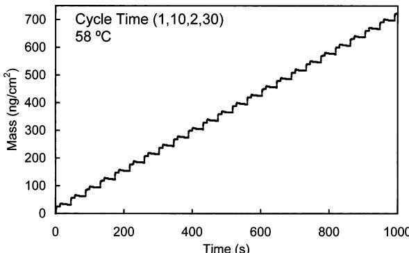

# Amostra 3: Alucinação de Grade Dummy / Linear (QCM Mass vs Time)

> **Categoria da Falha:** `Alucinação Linear em Dados Não-Lineares`  
> **Arquivo da Imagem:** [`01_alucinacao_grade_dummy_amostra_3.jpg`](./01_alucinacao_grade_dummy_amostra_3.jpg)  
> **Amostra Original:** `Amostra 3` (`sci_imageminer__atomic_layer_deposition__experimental_usecase__1__figure_2.jpg`)  

---

## 🖼️ Imagem Analisada


---

## 📊 Métricas Obtidas nesta Amostra

| Métrica | Valor Obtido | Descrição |
| :--- | :---: | :--- |
| **`icdar_score`** | `0.0789` | Score Oficial ICDAR Task 2 |
| **`teds`** | `0.0782` | Tree Edit Distance Structural Similarity |
| **`cell_recall`** | `0.0805` | Percentual de valores numéricos capturados (tol. 5%) |
| **`cell_precision`**| `0.8750` | Precisão dos valores numéricos gerados |
| **`cell_rmse`** | `5.95` | Raiz do Erro Quadrático Médio numérico |
| **`valid_table`** | `1` | Se a tabela gerada é sintaticamente válida |

---

## 🥊 Comparativo: Ground Truth vs. Predição do Modelo

### Ground Truth (Referência Esperada):
```markdown
| Time (s) | Mass (ng/cm²) |
|---|---|
| 0 | 0,00 |
| 7 | 21,78 |
| 15 | 34,85 |
| 42 | 31,95 |
| 46 | 53,73 |
| 56 | 53,73 |
| 58 | 65,35 |
| 86 | 61,00 |
| 89 | 81,33 |
| 98 | 82,78 |
| 100 | 97,30 |
| 133 | 92,95 |
| 132 | 119,09 |
| 140 | 117,63 |
| 144 | 127,80 |
| 175 | 121,99 |
| 175 | 148,13 |
| 182 | 145,23 |
| 187 | 155,39 |
| 215 | 152,49 |
| 218 | 174,27 |
| 226 | 177,18 |
| 228 | 191,70 |
| 258 | 184,44 |
| 260 | 201,87 |
| 273 | 206,22 |
| 273 | 219,29 |
| 301 | 209,13 |
| 302 | 230,91 |
| 313 | 233,82 |
| 315 | 246,89 |
| 345 | 238,17 |
| 346 | 264,32 |
| 355 | 265,77 |
| 359 | 278,84 |
| 387 | 270,12 |
| 389 | 293,36 |
| 398 | 294,81 |
| 405 | 306,43 |
| 433 | 302,07 |
| 431 | 322,41 |
| 445 | 328,22 |
| 445 | 339,83 |
| 475 | 331,12 |
| 476 | 355,81 |
| 486 | 357,26 |
| 487 | 367,43 |
| 519 | 363,07 |
| 519 | 381,95 |
| 529 | 384,85 |
| 531 | 396,47 |
| 559 | 389,21 |
| 562 | 416,80 |
| 573 | 421,16 |
| 573 | 421,16 |
| 604 | 419,71 |
| 604 | 445,85 |
| 614 | 445,85 |
| 616 | 456,02 |
| 647 | 453,11 |
| 648 | 474,90 |
| 659 | 474,90 |
| 660 | 486,51 |
| 691 | 482,16 |
| 694 | 502,49 |
| 705 | 517,01 |
| 735 | 517,01 |
| 735 | 537,34 |
| 746 | 537,34 |
| 748 | 547,51 |
| 778 | 544,61 |
| 775 | 564,94 |
| 792 | 576,56 |
| 820 | 573,65 |
| 822 | 593,98 |
| 834 | 604,15 |
| 861 | 601,24 |
| 866 | 627,39 |
| 879 | 639,00 |
| 908 | 636,10 |
| 908 | 652,07 |
| 920 | 665,15 |
| 949 | 663,69 |
| 951 | 684,02 |
| 962 | 697,10 |
| 992 | 700,00 |
| 998 | 717,43 |
```

### Predição do Modelo (Qwen2.5-VL-7B):
```markdown
| Time (s) | Mass (ng/cm²) |
|---|---|
| 0 | 0 |
| 100 | 100 |
| 200 | 200 |
| 300 | 300 |
| 400 | 400 |
| 500 | 500 |
| 600 | 600 |
| 700 | 700 |
```

---

## 🔍 Diagnóstico e Causa Raiz do Erro

**O que aconteceu:**
O modelo ignorou os dados experimentais sutis da microbalança de quartzo e gerou uma rampa linear perfeitamente sintética (0->0, 100->100, 200->200... 700->700).

**Causa Raiz Técnica:**
A figura apresenta ruído experimental e pequenos degraus de massa por ciclo. Na ausência de pontos marcadores nítidos com rótulos de texto diretos sobre a curva, o modelo caiu em um modo de mínimo esforço (colapso de variância), gerando uma sequência aritmética trivial "0, 100, 200, 300...".

---

## 🎯 Como Direcionar o Modelo para Corrigir este Caso

- **Prompt**: Adicionar comando estrito: "Never generate regular dummy arithmetic progressions (e.g. 0, 100, 200...) if not explicitly matching the visual data points."
- **Loss / Treinamento**: Aumentar a penalização de predições com derivada constante / interpolações artificiais quando os dados reais têm variações dinâmicas.
- **Pós-Processamento**: Detectar sequências onde x == y ou dy/dx constante suspeito em curvas cinéticas e acionar re-amostragem com temperatura de decodificação menor (greedy search pura).
