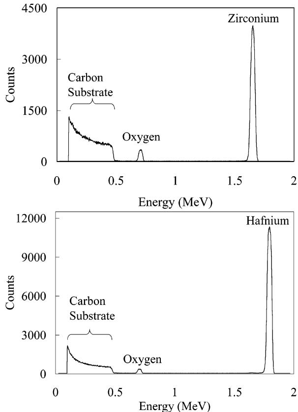

# Amostra 66: Interpolação de Ticks em Espectro de Picos (RBS)

> **Categoria da Falha:** `Falta de Peak-Picking em Espectros Físicos`  
> **Arquivo da Imagem:** [`02_alucinacao_grade_espectro_rbs_amostra_66.jpg`](./02_alucinacao_grade_espectro_rbs_amostra_66.jpg)  
> **Amostra Original:** `Amostra 66` (`sci_imageminer__atomic_layer_deposition__experimental_usecase__3__figure_2.jpg`)  

---

## 🖼️ Imagem Analisada


---

## 📊 Métricas Obtidas nesta Amostra

| Métrica | Valor Obtido | Descrição |
| :--- | :---: | :--- |
| **`icdar_score`** | `0.3107` | Score Oficial ICDAR Task 2 |
| **`teds`** | `0.1292` | Tree Edit Distance Structural Similarity |
| **`cell_recall`** | `0.5000` | Percentual de valores numéricos capturados (tol. 5%) |
| **`cell_precision`**| `0.1500` | Precisão dos valores numéricos gerados |
| **`cell_rmse`** | `37.19` | Raiz do Erro Quadrático Médio numérico |
| **`valid_table`** | `1` | Se a tabela gerada é sintaticamente válida |

---

## 🥊 Comparativo: Ground Truth vs. Predição do Modelo

### Ground Truth (Referência Esperada):
```markdown
| Energy (MeV) | Counts | Assignment |
|---|---|---|
| 0 | 0 | - |
| 0.098 | 1273 | Carbon Substrate |
| 0.46 | 443 | Carbon Substrate |
| 0.7 | 318 | Oxygen |
| 1.65 | 3987 | Zirconium |
| 2 | 0 | - |

| Energy (MeV) | Counts | Assignment |
|---|---|---|
| 0 | 0 | - |
| 0.098 | 2096 | Carbon Substrate |
| 0.46 | 578 | Carbon Substrate |
| 0.7 | 253 | Oxygen |
| 1.65 | 11240 | Hafnium |
| 2 | 0 | - |
```

### Predição do Modelo (Qwen2.5-VL-7B):
```markdown
| Energy (MeV) | Counts |
|---|---|
| 0.1 | 500 |
| 0.2 | 700 |
| 0.3 | 900 |
| 0.4 | 1100 |
| 0.5 | 1300 |
| 0.6 | 1500 |
| 0.7 | 1700 |
| 0.8 | 1900 |
| 0.9 | 2100 |
| 1.0 | 2300 |
| 1.1 | 2500 |
| 1.2 | 2700 |
| 1.3 | 2900 |
| 1.4 | 3100 |
| 1.5 | 3300 |
| 1.6 | 3500 |
| 1.7 | 3700 |
| 1.8 | 3900 |
| 1.9 | 4100 |
| 2.0 | 4300 |
```

---

## 🔍 Diagnóstico e Causa Raiz do Erro

**O que aconteceu:**
Em vez de identificar os picos discretos dos elementos químicos (C, O, Zr), o modelo gerou uma grade linear regular (0.1, 0.2, 0.3...) e omitiu a coluna categórica de identificação elementar.

**Causa Raiz Técnica:**
O gráfico de retroespalhamento de Rutherford (RBS) tem uma linha de base contínua com picos agudos característicos. O modelo tratou o espectro contínuo como uma tabela de ticks do eixo X, em vez de localizar apenas os picos de contagem e associar aos elementos identificados no gráfico.

---

## 🎯 Como Direcionar o Modelo para Corrigir este Caso

- **Prompt**: "For continuous spectroscopy charts (RBS, XRD, Raman, XPS), locate and extract ONLY physical peak maxima, peak assignments (element labels), and their exact coordinates. Do not extract regular grid intervals."
- **Dataset / Fine-Tuning**: Adicionar mais pares de espectroscopia RBS/XPS com colunas categóricas de atribuição elementar (| Element | Peak Energy | Counts |).
- **Atenção Visual**: O modelo 7B tem capacidade de reconhecer anotações flutuantes (ex: setas apontando para "Zr"), mas precisa ser condicionado a transformar o texto sobre o pico em uma coluna "Assignment".
