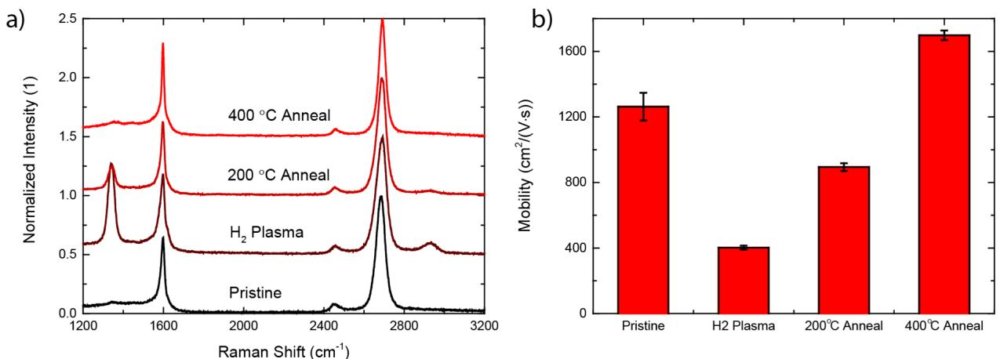

# Amostra 176: Leitura de Ticks de Eixo vs. Bandas Físicas (Raman Multi-Amostras)

> **Categoria da Falha:** `Leitura de Ticks em vez de Bandas Espectrais & Erro de Escala`  
> **Arquivo da Imagem:** [`03_leitura_ticks_espectro_raman_amostra_176.jpg`](./03_leitura_ticks_espectro_raman_amostra_176.jpg)  
> **Amostra Original:** `Amostra 176` (`sci_imageminer__atomic_layer_deposition__simulation_usecase__33__figure_6.jpg`)  

---

## 🖼️ Imagem Analisada


---

## 📊 Métricas Obtidas nesta Amostra

| Métrica | Valor Obtido | Descrição |
| :--- | :---: | :--- |
| **`icdar_score`** | `0.3476` | Score Oficial ICDAR Task 2 |
| **`teds`** | `0.4977` | Tree Edit Distance Structural Similarity |
| **`cell_recall`** | `0.2000` | Percentual de valores numéricos capturados (tol. 5%) |
| **`cell_precision`**| `0.2667` | Precisão dos valores numéricos gerados |
| **`cell_rmse`** | `50.99` | Raiz do Erro Quadrático Médio numérico |
| **`valid_table`** | `1` | Se a tabela gerada é sintaticamente válida |

---

## 🥊 Comparativo: Ground Truth vs. Predição do Modelo

### Ground Truth (Referência Esperada):
```markdown
| Raman Shift, cm⁻¹ | Peak | Pristine | H₂ Plasma | 200°C Anneal | 400°C Anneal |
|---|---|---|---|---|---|
| 1350 | D | 0.05 | 0.15 | 0.12 | 0.08 |
| 1580 | G | 0.55 | 0.70 | 0.75 | 0.80 |
| 2450 | D+D' | 0.05 | 0.08 | 0.06 | 0.05 |
| 2700 | 2D | 1.00 | 0.45 | 0.50 | 0.55 |

| Treatment Stage | Mobility (cm²/(V·s)) |
|---|---|
| Pristine | 1250 |
| H₂ Plasma | 400 |
| 200°C Anneal | 900 |
| 400°C Anneal | 1700 |
```

### Predição do Modelo (Qwen2.5-VL-7B):
```markdown
| Raman Shift (cm⁻¹) | Pristine | H₂ Plasma | 200°C Anneal | 400°C Anneal |
|---|---|---|---|---|
| 1200 | 0.0 | 0.0 | 0.0 | 0.0 |
| 1600 | 0.0 | 0.5 | 1.0 | 1.5 |
| 2800 | 0.0 | 0.0 | 0.0 | 2.5 |
```

---

## 🔍 Diagnóstico e Causa Raiz do Erro

**O que aconteceu:**
O modelo leu os rótulos de grade (1200, 1600, 2800 cm⁻¹) em vez de ancorar nas bandas físicas do grafeno (D em 1350, G em 1580, 2D em 2700), além de extrapolar a amplitude para 2.5 (a escala máxima era 1.0). Teve RMSE de 50.99.

**Causa Raiz Técnica:**
O modelo focou sua atenção nos números impressos nos eixos cartesianos (ticks de 400 em 400 cm⁻¹) em vez dos máximos locais das bandas de vibração física. Além disso, alucinou a escala vertical, colocando intensidades de até 2.5 em um eixo normalizado de 0.0 a 1.0.

---

## 🎯 Como Direcionar o Modelo para Corrigir este Caso

- **Prompt**: "For Raman spectra, identify prominent vibrational modes (e.g., D, G, 2D bands) and strictly observe axis limits when estimating normalized intensities."
- **Injeção de Metadados**: Se a legenda indicar o tipo de gráfico (Raman), fornecer dicas no prompt do sistema sobre a faixa de eixos esperada.
- **Resolução Original**: Forçar o modelo a rodar na resolução nativa (sem downsampling para 256px) para que os números dos ticks do eixo Y fiquem perfeitamente nítidos.
