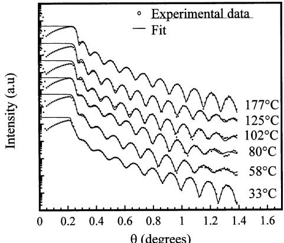

# Amostra 8: Subamostragem Brutal e Confusão de Eixos (Difratograma XRD)

> **Categoria da Falha:** `Colapso de Resolução e Confusão de Grandeza Cartesiana`  
> **Arquivo da Imagem:** [`04_subamostragem_extrema_eixo_xrd_amostra_8.jpg`](./04_subamostragem_extrema_eixo_xrd_amostra_8.jpg)  
> **Amostra Original:** `Amostra 8` (`sci_imageminer__atomic_layer_deposition__experimental_usecase__1__figure_8.jpg`)  

---

## 🖼️ Imagem Analisada


---

## 📊 Métricas Obtidas nesta Amostra

| Métrica | Valor Obtido | Descrição |
| :--- | :---: | :--- |
| **`icdar_score`** | `0.0108` | Score Oficial ICDAR Task 2 |
| **`teds`** | `0.0143` | Tree Edit Distance Structural Similarity |
| **`cell_recall`** | `0.0073` | Percentual de valores numéricos capturados (tol. 5%) |
| **`cell_precision`**| `1.0000` | Precisão dos valores numéricos gerados |
| **`cell_rmse`** | `0.00` | Raiz do Erro Quadrático Médio numérico |
| **`valid_table`** | `1` | Se a tabela gerada é sintaticamente válida |

---

## 🥊 Comparativo: Ground Truth vs. Predição do Modelo

### Ground Truth (Referência Esperada):
```markdown
| Temperature (°C) | Source |  θ (degrees) | Intensity (a.u.) |
|---| ---| ---| ---| 
| 33 | Experimental | 0.05 | 27685.5733 |
| 33 | Experimental | 0.21 | 118369.3974 |
| 33 | Experimental | 0.27 | 7090.946772 |
| 33 | Experimental | 0.32 | 5160.313139 |
| 33 | Experimental | 0.39 | 1263.014832 |
| 33 | Experimental | 0.42 | 1263.014832 |
| 33 | Experimental | 0.48 | 282 |
| 33 | Experimental | 0.53 | 371 |
| 33 | Experimental | 0.59 | 76 |
| 33 | Experimental | 0.66 | 149.5023046 |
| 33 | Experimental | 0.73 | 27.86572986 |
| 33 | Experimental | 0.79 | 66.02650509 |
| 33 | Experimental | 0.86 | 8 |
| 33 | Experimental | 0.93 | 32 |
| 33 | Experimental | 0.99 | 15 |
| 33 | Experimental | 1.06 | 1 |
| 33 | Experimental | 1.12 | 1 |
| 33 | Experimental | 1.19 | 9 |
| 33 | Experimental | 1.25 | 0 |
| 33 | Experimental | 1.32 | 0 |
| 33 | Experimental | 1.38 | 0 |
| 33 | Fit | 0.01 | 186390 |
| 33 | Fit | 0.21 | 195048 |
| 33 | Fit | 0.28 | 6475.41498 |
| 33 | Fit | 0.32 | 4303.311825 |
| 33 | Fit | 0.37 | 1102.182525 |
| 33 | Fit | 0.42 | 1206.952395 |
| 33 | Fit | 0.48 | 295.4081924 |
| 33 | Fit | 0.52 | 370.6927434 |
| 33 | Fit | 0.60 | 72.30276894 |
| 33 | Fit | 0.67 | 130.4646813 |
| 33 | Fit | 0.73 | 22.20643655 |
| 33 | Fit | 0.79 | 69.09340882 |
| 33 | Fit | 0.86 | 6.820289616 |
| 33 | Fit | 0.92 | 29.16008143 |
| 33 | Fit | 0.99 | 2.293841366 |
| 33 | Fit | 1.05 | 13.47651082 |
| 33 | Fit | 1.12 | 0.884054162 |
| 33 | Fit | 1.19 | 8.178545165 |
| 33 | Fit | 1.25 | 0.311141361 |
| 33 | Fit | 1.32 | 4.743035094 |
| 33 | Fit | 1.38 | 0.28413264 |
| 58 | Experimental | 0.04 | 1046449.584 |
| 58 | Experimental | 0.22 | 4899376.842 |
| 58 | Experimental | 0.27 | 308964.918 |
| 58 | Experimental | 0.31 | 293498.3296 |
| 58 | Experimental | 0.35 | 38043.60731 |
| 58 | Experimental | 0.41 | 49956.44773 |
| 58 | Experimental | 0.46 | 7764.989004 |
| 58 | Experimental | 0.52 | 12227.1135 |
| 58 | Experimental | 0.58 | 1584.893192 |
| 58 | Experimental | 0.64 | 4516.425774 |
| 58 | Experimental | 0.71 | 370.6927434 |
| 58 | Experimental | 0.77 | 1263.014832 |
| 58 | Experimental | 0.83 | 94.94340189 |
| 58 | Experimental | 0.89 | 486.770156 |
| 58 | Experimental | 0.95 | 38.29116603 |
| 58 | Experimental | 1.02 | 224.963819 |
| 58 | Experimental | 1.08 | 34.69398579 |
| 58 | Experimental | 1.15 | 103.9684115 |
| 58 | Experimental | 1.22 | 33.415169 |
| 58 | Experimental | 1.30 | 63.09573445 |
| 58 | Experimental | 1.39 | 22.20643655 |
| 58 | Fit | 0.01 | 7372344.717 |
| 58 | Fit | 0.22 | 7045102.627 |
| 58 | Fit | 0.27 | 336326.0939 |
| 58 | Fit | 0.31 | 321397.3117 |
| 58 | Fit | 0.35 | 43594.99375 |
| 58 | Fit | 0.40 | 47736.99142 |
| 58 | Fit | 0.46 | 7420.318303 |
| 58 | Fit | 0.52 | 11684.37895 |
| 58 | Fit | 0.58 | 1584.893192 |
| 58 | Fit | 0.64 | 3755.328103 |
| 58 | Fit | 0.70 | 370.6927434 |
| 58 | Fit | 0.76 | 1584.893192 |
| 58 | Fit | 0.83 | 94.94340189 |
| 58 | Fit | 0.89 | 465.1635045 |
| 58 | Fit | 0.95 | 43.87867665 |
| 58 | Fit | 1.01 | 246.3481447 |
| 58 | Fit | 1.08 | 36.59150579 |
| 58 | Fit | 1.15 | 103.9684115 |
| 58 | Fit | 1.22 | 31.9319435 |
| 58 | Fit | 1.29 | 66.02650509 |
| 58 | Fit | 1.38 | 43.87867665 |
| 80 | Experimental | 0.04 | 21920226.17 |
| 80 | Experimental | 0.21 | 93719720.76 |
| 80 | Experimental | 0.26 | 6147979.269 |
| 80 | Experimental | 0.30 | 5614302.058 |
| 80 | Experimental | 0.35 | 1000000 |
| 80 | Experimental | 0.39 | 1313136.458 |
| 80 | Experimental | 0.44 | 293498.3296 |
| 80 | Experimental | 0.51 | 307131.205 |
| 80 | Experimental | 0.56 | 57246.17566 |
| 80 | Experimental | 0.61 | 103296.2385 |
| 80 | Experimental | 0.67 | 15343.18399 |
| 80 | Experimental | 0.73 | 39810.71706 |
| 80 | Experimental | 0.79 | 3588.637388 |
| 80 | Experimental | 0.84 | 14011.31424 |
| 80 | Experimental | 0.91 | 1098.357236 |
| 80 | Experimental | 0.97 | 5400.00754 |
| 80 | Experimental | 1.04 | 639.1956383 |
| 80 | Experimental | 1.10 | 2279.011302 |
| 80 | Experimental | 1.14 | 699.9554873 |
| 80 | Experimental | 1.22 | 1321.681346 |
| 80 | Experimental | 1.28 | 699.9554873 |
| 80 | Experimental | 1.34 | 1006.507236 |
| 80 | Experimental | 1.40 | 769.185523 |
| 80 | Fit | 0.01 | 102628411.2 |
| 80 | Fit | 0.21 | 98072962.84 |
| 80 | Fit | 0.27 | 5365095.597 |
| 80 | Fit | 0.30 | 5365095.597 |
| 80 | Fit | 0.34 | 913194.6958 |
| 80 | Fit | 0.39 | 1254849.232 |
| 80 | Fit | 0.44 | 307131.205 |
| 80 | Fit | 0.50 | 336326.0939 |
| 80 | Fit | 0.56 | 57246.17566 |
| 80 | Fit | 0.61 | 108094.3058 |
| 80 | Fit | 0.67 | 13389.38296 |
| 80 | Fit | 0.73 | 38043.60731 |
| 80 | Fit | 0.79 | 3755.328103 |
| 80 | Fit | 0.85 | 15343.18399 |
| 80 | Fit | 0.91 | 961.830604 |
| 80 | Fit | 0.97 | 4712.370587 |
| 80 | Fit | 1.03 | 699.9554873 |
| 80 | Fit | 1.08 | 1900.52348 |
| 80 | Fit | 1.16 | 610.8231565 |
| 80 | Fit | 1.21 | 1206.952395 |
| 80 | Fit | 1.27 | 639.1956383 |
| 80 | Fit | 1.34 | 961.830604 |
| 80 | Fit | 1.40 | 769.185523 |
| 102 | Experimental | 0.04 | 176964977 |
| 102 | Experimental | 0.23 | 791756339.3 |
| 102 | Experimental | 0.26 | 71370892.35 |
| 102 | Experimental | 0.28 | 102628411.2 |
| 102 | Experimental | 0.33 | 13302818.38 |
| 102 | Experimental | 0.36 | 17468415.81 |
| 102 | Experimental | 0.42 | 2715206.202 |
| 102 | Experimental | 0.47 | 5365095.597 |
| 102 | Experimental | 0.52 | 761535.476 |
| 102 | Experimental | 0.57 | 1647788.276 |
| 102 | Experimental | 0.63 | 233691.309 |
| 102 | Experimental | 0.68 | 833924.5525 |
| 102 | Experimental | 0.73 | 75172.04032 |
| 102 | Experimental | 0.78 | 268021.1178 |
| 102 | Experimental | 0.85 | 31725.4982 |
| 102 | Experimental | 0.90 | 128325.7474 |
| 102 | Experimental | 0.96 | 16801.65693 |
| 102 | Experimental | 1.01 | 68646.70849 |
| 102 | Experimental | 1.07 | 9311.380725 |
| 102 | Experimental | 1.12 | 27685.5733 |
| 102 | Experimental | 1.18 | 7090.946772 |
| 102 | Experimental | 1.24 | 16055.86851 |
| 102 | Experimental | 1.30 | 4712.370587 |
| 102 | Experimental | 1.35 | 13131.36979 |
| 102 | Experimental | 1.38 | 7090.946772 |
| 102 | Fit | 0.02 | 1304646813 |
| 102 | Fit | 0.22 | 1138513090 |
| 102 | Fit | 0.26 | 81785451.65 |
| 102 | Fit | 0.29 | 112383932.7 |
| 102 | Fit | 0.33 | 12148063.19 |
| 102 | Fit | 0.37 | 17468415.81 |
| 102 | Fit | 0.42 | 2911634.782 |
| 102 | Fit | 0.47 | 5365095.597 |
| 102 | Fit | 0.52 | 833924.5525 |
| 102 | Fit | 0.57 | 1574646.596 |
| 102 | Fit | 0.63 | 223509.3907 |
| 102 | Fit | 0.68 | 796908.4845 |
| 102 | Fit | 0.74 | 94329.57708 |
| 102 | Fit | 0.79 | 336326.0939 |
| 102 | Fit | 0.85 | 31310.8242 |
| 102 | Fit | 0.91 | 129621.2056 |
| 102 | Fit | 0.95 | 17582.08691 |
| 102 | Fit | 1.01 | 57246.17566 |
| 102 | Fit | 1.06 | 10670.11288 |
| 102 | Fit | 1.12 | 33199.1344 |
| 102 | Fit | 1.18 | 6187.98562 |
| 102 | Fit | 1.24 | 16266.6067 |
| 102 | Fit | 1.30 | 5160.313139 |
| 102 | Fit | 1.38 | 12795.05784 |
| 125 | Experimental | 0.05 | 2822956756 |
| 125 | Experimental | 0.23 | 11533784455 |
| 125 | Experimental | 0.27 | 949434018.9 |
| 125 | Experimental | 0.30 | 1191396550 |
| 125 | Experimental | 0.33 | 1656828977 |
| 125 | Experimental | 0.37 | 278657298.6 |
| 125 | Experimental | 0.43 | 39553334.18 |
| 125 | Experimental | 0.48 | 81785451.65 |
| 125 | Experimental | 0.54 | 9251181.108 |
| 125 | Experimental | 0.57 | 26285625.12 |
| 125 | Experimental | 0.63 | 2973304.832 |
| 125 | Experimental | 0.68 | 12148063.19 |
| 125 | Experimental | 0.74 | 1199149.248 |
| 125 | Experimental | 0.79 | 4303311.825 |
| 125 | Experimental | 0.85 | 529594.7388 |
| 125 | Experimental | 0.90 | 2479511.901 |
| 125 | Experimental | 0.96 | 293498.3296 |
| 125 | Experimental | 1.01 | 1095056.733 |
| 125 | Experimental | 1.07 | 195047.7052 |
| 125 | Experimental | 1.13 | 529594.7388 |
| 125 | Experimental | 1.19 | 113115.2414 |
| 125 | Experimental | 1.25 | 268021.1178 |
| 125 | Experimental | 1.31 | 98711.14674 |
| 125 | Experimental | 1.36 | 186389.9686 |
| 125 | Experimental | 1.38 | 123867.6067 |
| 125 | Fit | 0.02 | 22790113017 |
| 125 | Fit | 0.23 | 19005234799 |
| 125 | Fit | 0.26 | 1039684115 |
| 125 | Fit | 0.33 | 1342674991 |
| 125 | Fit | 0.38 | 296614457.7 |
| 125 | Fit | 0.43 | 185184926.6 |
| 125 | Fit | 0.47 | 319319435 |
| 125 | Fit | 0.53 | 36119894.98 |
| 125 | Fit | 0.58 | 85584351.89 |
| 125 | Fit | 0.64 | 10601128.84 |
| 125 | Fit | 0.69 | 30121267.25 |
| 125 | Fit | 0.74 | 3111413.606 |
| 125 | Fit | 0.79 | 12148063.19 |
| 125 | Fit | 0.85 | 1183693.974 |
| 125 | Fit | 0.90 | 5365095.597 |
| 125 | Fit | 0.96 | 579936.2843 |
| 125 | Fit | 1.01 | 2369451.848 |
| 125 | Fit | 1.08 | 268021.1178 |
| 125 | Fit | 1.13 | 1145921.663 |
| 125 | Fit | 1.19 | 170210.3307 |
| 125 | Fit | 1.24 | 554216.0441 |
| 125 | Fit | 1.30 | 113115.2414 |
| 125 | Fit | 1.36 | 268021.1178 |
| 125 | Fit | 1.38 | 94329.57708 |
| 177 | Experimental | 0.04 | 64754149804 |
| 177 | Experimental | 0.23 | 3.03173E+11 |
| 177 | Experimental | 0.26 | 23924719221 |
| 177 | Experimental | 0.30 | 26115684208 |
| 177 | Experimental | 0.35 | 2954081924 |
| 177 | Experimental | 0.40 | 5330409366 |
| 177 | Experimental | 0.44 | 791756339.3 |
| 177 | Experimental | 0.49 | 1564466245 |
| 177 | Experimental | 0.55 | 222064365.5 |
| 177 | Experimental | 0.61 | 438786766.5 |
| 177 | Experimental | 0.67 | 68202896.16 |
| 177 | Experimental | 0.73 | 193766693.5 |
| 177 | Experimental | 0.79 | 21920226.17 |
| 177 | Experimental | 0.84 | 78155176.19 |
| 177 | Experimental | 0.91 | 7714787.065 |
| 177 | Experimental | 0.96 | 34516612.66 |
| 177 | Experimental | 1.03 | 2841326.401 |
| 177 | Experimental | 1.09 | 16693031.44 |
| 177 | Experimental | 1.15 | 1087373.868 |
| 177 | Experimental | 1.21 | 10130568.16 |
| 177 | Experimental | 1.26 | 529594.7388 |
| 177 | Experimental | 1.33 | 5365095.597 |
| 177 | Experimental | 1.38 | 441642.0555 |
| 177 | Fit | 0.05 | 64754149804 |
| 177 | Fit | 0.23 | 2.76856E+11 |
| 177 | Fit | 0.26 | 2.52988E+10 |
| 177 | Fit | 0.29 | 28598155823 |
| 177 | Fit | 0.35 | 3385146471 |
| 177 | Fit | 0.39 | 5093804275 |
| 177 | Fit | 0.45 | 867018110.1 |
| 177 | Fit | 0.49 | 1495023046 |
| 177 | Fit | 0.55 | 254468367 |
| 177 | Fit | 0.61 | 502815261.2 |
| 177 | Fit | 0.67 | 68202896.16 |
| 177 | Fit | 0.73 | 195047705 |
| 177 | Fit | 0.79 | 22938413.66 |
| 177 | Fit | 0.84 | 81785451.65 |
| 177 | Fit | 0.91 | 8073135.718 |
| 177 | Fit | 0.96 | 34516612.66 |
| 177 | Fit | 1.03 | 2479511.901 |
| 177 | Fit | 1.09 | 17468415.81 |
| 177 | Fit | 1.15 | 1000000 |
| 177 | Fit | 1.21 | 8840541.623 |
| 177 | Fit | 1.27 | 483623.1064 |
| 177 | Fit | 1.33 | 4899376.842 |
| 177 | Fit | 1.38 | 483623.1064 |
```

### Predição do Modelo (Qwen2.5-VL-7B):
```markdown
| Temperature (°C) | Intensity (a.u.) |
|------------------|------------------|
| 33               | ~0.5             |
| 58               | ~0.4             |
| 80               | ~0.3             |
| 102              | ~0.25            |
| 125              | ~0.2             |
| 177              | ~0.15            |
```

---

## 🔍 Diagnóstico e Causa Raiz do Erro

**O que aconteceu:**
A curva contínua continha 274 pontos medidos em função do ângulo θ. O modelo resumiu em apenas 6 linhas e usou a temperatura das amostras (33, 58, 80 °C) como se fosse o eixo X em vez do ângulo de difração.
