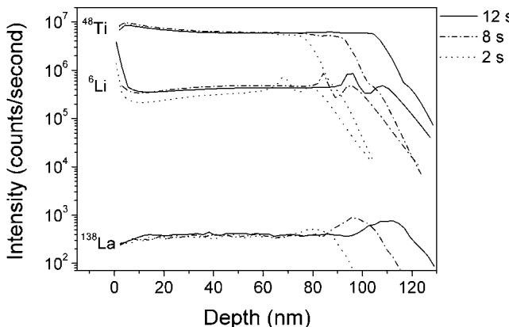

# Amostra 37: Inversão de Formato (Wide vs Long) e Notação Qualitativa com Til (~)

> **Categoria da Falha:** `Divergência de Formato de Tabela e Incerteza Numérica`  
> **Arquivo da Imagem:** [`05_pivotacao_wide_long_til_amostra_37.jpg`](./05_pivotacao_wide_long_til_amostra_37.jpg)  
> **Amostra Original:** `Amostra 37` (`sci_imageminer__atomic_layer_deposition__experimental_usecase__20__fig_6.jpg`)  

---

## 🖼️ Imagem Analisada


---

## 📊 Métricas Obtidas nesta Amostra

| Métrica | Valor Obtido | Descrição |
| :--- | :---: | :--- |
| **`icdar_score`** | `0.0430` | Score Oficial ICDAR Task 2 |
| **`teds`** | `0.0518` | Tree Edit Distance Structural Similarity |
| **`cell_recall`** | `0.0347` | Percentual de valores numéricos capturados (tol. 5%) |
| **`cell_precision`**| `0.7143` | Precisão dos valores numéricos gerados |
| **`cell_rmse`** | `1.79` | Raiz do Erro Quadrático Médio numérico |
| **`valid_table`** | `1` | Se a tabela gerada é sintaticamente válida |

---

## 🥊 Comparativo: Ground Truth vs. Predição do Modelo

### Ground Truth (Referência Esperada):
```markdown
| Species | Pulse time (s) | Depth (nm) | Intensity (counts/second) |
|---|---|---|---|
| La-138 | 12 | 2.85 | 240 |
| La-138 | 12 | 20.4| 369 |
| La-138 | 12 | 95.1| 376 |
| La-138 | 12 | 111.45| 779 |
| La-138 | 12 | 128.7 | 87 |
| La-138  | 8 | 2.85 | 241 | 
| La-138  | 8 | 18.9 | 362 | 
| La-138  | 8 | 83.7 |376 | 
| La-138  | 8 | 96.3 | 867 | 
| La-138  | 8 | 115.05 | 72 | 
| La-138  | 2 | 2.85 | 241 | 
| La-138  | 2 | 18.9  | 362 | 
| La-138  | 2 | 71.85 | 389 | 
| La-138  | 2 | 79.8  | 499 | 
| La-138  | 2 | 95.85 | 71 | 
| Li-6  | 12 | 0.89  |   3869268  | 
| Li-6  | 12 | 5.7 |  448809  | 
| Li-6  | 12 | 91.35 |  490593  | 
| Li-6  | 12 | 94.95 |  851946  | 
| Li-6  | 12 | 102.3 |  349796  | 
| Li-6  | 12 | 108.45 |  481936  | 
| Li-6  | 12 | 127.2 |  42045  | 
| Li-6  | 8 | 3.15 |  481936 | 
| Li-6  | 8 | 79.35 | 481936 | 
| Li-6  | 8 | 84.75 | 882828 | 
| Li-6  | 8 | 89.4 | 282508 | 
| Li-6  | 8 | 95.4 | 481936 | 
| Li-6  | 8 | 123.15 | 7748 | 
| Li-6  | 2 | 0.75 |  1402514 | 
| Li-6  | 2 | 8.25 |  228164 | 
| Li-6  | 2 | 60.75 |  382362 | 
| Li-6  | 2 | 68.4 |  675923 | 
| Li-6  | 2 | 75 |  362475 | 
| Li-6  | 2 | 123.159 |  7748 | 
| Li-6  | 2 | 79.2 |  490593 | 
| Li-6  | 2 | 103 |  14448 | 
| Ti-48  | 12 | 2.1 | 7215184 |
| Ti-48  | 12 | 5.25 | 8933691 |
| Ti-48  | 12 | 104.1 | 5931928 |
| Ti-48  | 12 | 128.7 | 75659.94 |
| Ti-48  | 8 | 2.1 | 8621186 |
| Ti-48  | 8 | 4.95 | 9940831 |
| Ti-48  | 8 | 90.6 | 4876905 |
| Ti-48  | 8 | 123.6 | 8029 |
| Ti-48  | 2 | 2.1 |8621186 |
| Ti-48  | 2 | 4.95 | 9940831 |
| Ti-48  | 2 | 74.55 | 5524183 |
| Ti-48  | 2 | 103.95 | 14971 |
```

### Predição do Modelo (Qwen2.5-VL-7B):
```markdown
| Depth (nm) | 12 s | 8 s | 2 s |
|---|---|---|---|
| 0 | ~10^7 | ~10^6 | ~10^5 |
| 20 | ~10^7 | ~10^6 | ~10^5 |
| 40 | ~10^7 | ~10^6 | ~10^5 |
| 60 | ~10^7 | ~10^6 | ~10^5 |
| 80 | ~10^7 | ~10^6 | ~10^5 |
| 100 | ~10^7 | ~10^6 | ~10^5 |
| 120 | ~10^7 | ~10^6 | ~10^5 |
```

---

## 🔍 Diagnóstico e Causa Raiz do Erro

**O que aconteceu:**
O modelo pivotou tempos de pulso em colunas independentes e usou notação com til (~10^7). Isso zerou o casamento numérico com o Ground Truth (que estava em formato longo/tidy) e quebrou o parser de floats.

**Causa Raiz Técnica:**
Cientificamente, tabular como colunas largas (| Depth | 12 s | 8 s | 2 s |) faz sentido humano, mas o Ground Truth do benchmark foi anotado em formato tidy longo (| Species | Pulse time | Depth | Intensity |). Além disso, o modelo usou o caractere til "~" para denotar valor aproximado visualmente, o que causou falha no parser numérico.
