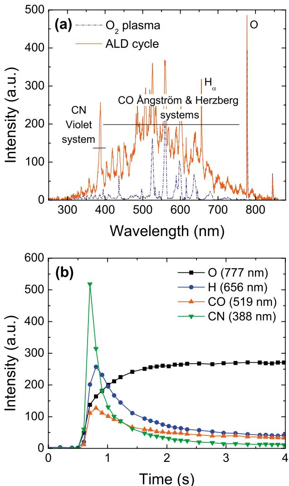

# Amostra 105: Omissão de Múltiplos Painéis por Early Stopping

> **Categoria da Falha:** `Negligência de Subplots Múltiplos`  
> **Arquivo da Imagem:** [`06_omissao_multi_painel_amostra_105.jpg`](./06_omissao_multi_painel_amostra_105.jpg)  
> **Amostra Original:** `Amostra 105` (`sci_imageminer__atomic_layer_deposition__experimental_usecase__62__fig_4.jpg`)  

---

## 🖼️ Imagem Analisada


---

## 📊 Métricas Obtidas nesta Amostra

| Métrica | Valor Obtido | Descrição |
| :--- | :---: | :--- |
| **`icdar_score`** | `0.3528` | Score Oficial ICDAR Task 2 |
| **`teds`** | `0.2184` | Tree Edit Distance Structural Similarity |
| **`cell_recall`** | `0.5000` | Percentual de valores numéricos capturados (tol. 5%) |
| **`cell_precision`**| `0.0833` | Precisão dos valores numéricos gerados |
| **`cell_rmse`** | `20.00` | Raiz do Erro Quadrático Médio numérico |
| **`valid_table`** | `1` | Se a tabela gerada é sintaticamente válida |

---

## 🥊 Comparativo: Ground Truth vs. Predição do Modelo

### Ground Truth (Referência Esperada):
```markdown
| Wavelength (nm) | Intensity (a.u.) O2 plasma |Intensity (a.u.) O2 plasma after ALD cycle |
|---|---|---|
| 360-400 | - | CN range |
| 400-750 | - | CO range |
| 660 | - | H alpha peak |
| 780 | O peak |O peak |

| Time (s) | Intensity (a.u.) O |Intensity (a.u.) H |Intensity (a.u.) CO |Intensity (a.u.) CN |
|----------|------------------|----------|----------|------------------|
| 0        | 0     |0     |0     |0     |
| 0.5      | 0     |0     |0     |0     |
| 1        | 200   | 200   |100|100|
| 1.5      | 250   |130|80|80|
| 2        | 260    |80|50|50|
| 2.5      | 260    |50|50|20|
| 3        | 260    |50|50|20|
| 3.5      | 260    |50|50|20|
| 4        | 260    |50|50|20|
```

### Predição do Modelo (Qwen2.5-VL-7B):
```markdown
| Wavelength (nm) | Intensity (a.u.) |
|---|---|
| 300 | 0 |
| 400 | 100 |
| 500 | 200 |
| 600 | 300 |
| 700 | 400 |
| 800 | 500 |
```

---

## 🔍 Diagnóstico e Causa Raiz do Erro

**O que aconteceu:**
A figura continha dois painéis lado a lado (Espectro OES no Painel A e Evolução Temporal no Painel B). O modelo encerrou a resposta ao terminar o Painel A, omitindo 100% dos dados do Painel B.

**Causa Raiz Técnica:**
O modelo foi treinado majoritariamente em imagens com tabela única. Quando encontrou uma figura composta com sub-gráficos (a) e (b), interpretou a conclusão da tabela do primeiro gráfico como condição de parada (<|im_end|>).
