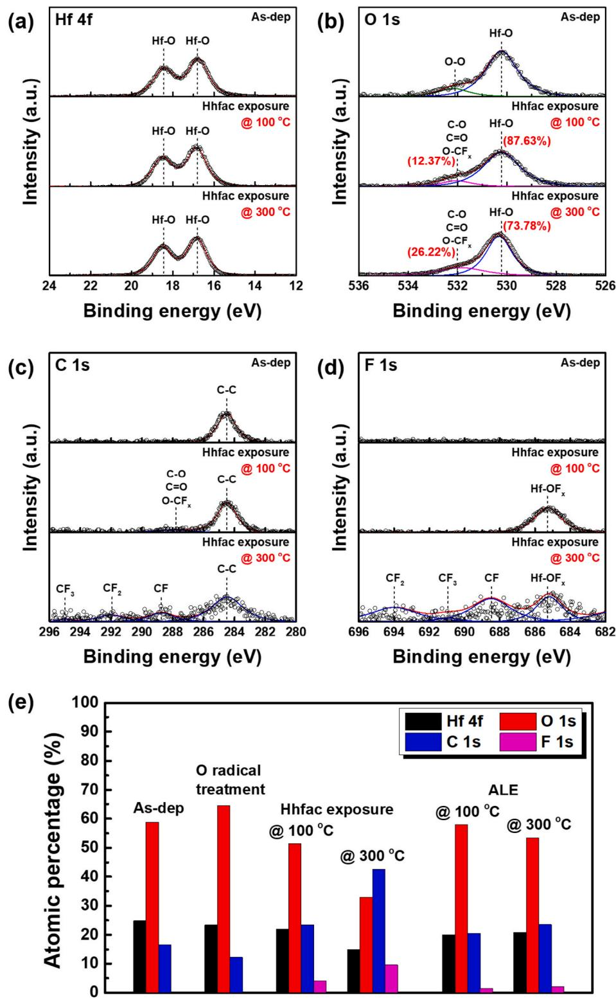

# Amostra 266: Conflito Espectro Contínuo vs. Tabela Resumo Embutida

> **Categoria da Falha:** `Desalinhamento de Foco Visual`  
> **Arquivo da Imagem:** [`07_alvo_espectro_vs_tabela_resumo_amostra_266.jpg`](./07_alvo_espectro_vs_tabela_resumo_amostra_266.jpg)  
> **Amostra Original:** `Amostra 266` (`sci_imageminer__atomic_layer_etching__experimental_usecase__31__fig_4.jpg`)  

---

## 🖼️ Imagem Analisada


---

## 📊 Métricas Obtidas nesta Amostra

| Métrica | Valor Obtido | Descrição |
| :--- | :---: | :--- |
| **`icdar_score`** | `0.0146` | Score Oficial ICDAR Task 2 |
| **`teds`** | `0.0292` | Tree Edit Distance Structural Similarity |
| **`cell_recall`** | `0.0000` | Percentual de valores numéricos capturados (tol. 5%) |
| **`cell_precision`**| `0.0000` | Precisão dos valores numéricos gerados |
| **`cell_rmse`** | `nan` | Raiz do Erro Quadrático Médio numérico |
| **`valid_table`** | `1` | Se a tabela gerada é sintaticamente válida |

---

## 🥊 Comparativo: Ground Truth vs. Predição do Modelo

### Ground Truth (Referência Esperada):
```markdown
| Treatment                  | Hf-O (%) | O-O, C-O, C=O, O-CF (%) |
|---------------------------|----------|--------------------------|
| Hhfac exposure @ 100 °C   | 87.63    | 12.37                    |
| Hhfac exposure @ 300 °C   | 73.78    | 26.22                    |

| Treatment                     | Hf 4f (%) | O 1s (%) | C 1s (%) | F 1s (%) |
|------------------------------|-----------|----------|----------|----------|
| As-dep                       | 25        | 60       | 15       | 10       |
| O radical treatment          | 60        | 65       | 15       | 5        |
| Hhfac exposure @ 100 °C      | 22        | 55       | 33       | 12       |
| Hhfac exposure @ 300 °C      | 20        | 55       | 40       | 10       |
| ALE @ 100 °C                 | 22        | 55       | 20       | 5        |
| ALE @ 300 °C                 | 20        | 55       | 20       | 5        |
```

### Predição do Modelo (Qwen2.5-VL-7B):
```markdown
| Binding energy (eV) | Intensity (a.u.) | Peak label |
|---|---|---|
| 24-28 | - | - |
| 28-30 | - | - |
| 30-32 | - | - |
| 32-34 | - | - |
| 34-36 | - | - |
| 36-38 | - | - |
| 38-40 | - | - |
| 40-42 | - | - |
| 42-44 | - | - |
| 44-46 | - | - |
| 46-48 | - | - |
| 48-50 | - | - |
| 50-52 | - | - |
| 52-54 | - | - |
| 54-56 | - | - |
| 56-58 | - | - |
| 58-60 | - | - |
| 60-62 | - | - |
| 62-64 | - | - |
| 64-66 | - | - |
| 66-68 | - | - |
| 68-70 | - | - |
| 70-72 | - | - |
| 72-74 | - | - |
| 74-76 | - | - |
| 76-78 | - | - |
| 78-80 | - | - |
| 80-82 | - | - |
| 82-84 | - | - |
| 84-86 | - | - |
| 86-88 | - | - |
| 88-90 | - | - |
| 90-92 | - | - |
| 92-94 | - | - |
| 94-96 | - | - |
| 96-98 | - | - |
| 98-100 | - | - |
```

---

## 🔍 Diagnóstico e Causa Raiz do Erro

**O que aconteceu:**
A imagem XPS continha uma tabela sobreposta com porcentagens de composição (Hf-O, etc.). O modelo tentou ler o espectro contínuo gerando faixas vazias (-), ignorando a tabela explícita com os dados de interesse.

**Causa Raiz Técnica:**
Figuras científicas frequentemente contêm mini-tabelas inseridas no canto do gráfico sintetizando a integração de área dos picos (ex: Hf-O % = 87.63). O modelo priorizou o fundo visual (o espectro de binding energy) e gerou células nulas em vez de transcrever os números consolidados do encarte.

---

## 🎯 Como Direcionar o Modelo para Corrigir este Caso

- **Prompt**: "If the figure includes an inset table, summary box, or elemental composition breakdown, prioritize or include these summarized values as key columns."
- **Multi-modal OCR**: O Vision Encoder precisa ser incentivado a ler caixas de texto estruturadas embutidas no plot antes de tentar digitalizar a linha contínua de fundo.
