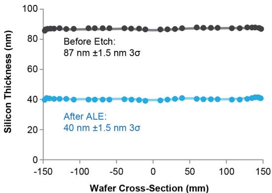

# Amostra 337: Nível de Abstração Espacial vs. Condições Globais

> **Categoria da Falha:** `Divergência de Semântica e Nível de Agregação`  
> **Arquivo da Imagem:** [`08_perfil_espacial_vs_condicoes_amostra_337.jpg`](./08_perfil_espacial_vs_condicoes_amostra_337.jpg)  
> **Amostra Original:** `Amostra 337` (`sci_imageminer__atomic_layer_etching__simulation_usecase__21__figure_6.jpg`)  

---

## 🖼️ Imagem Analisada


---

## 📊 Métricas Obtidas nesta Amostra

| Métrica | Valor Obtido | Descrição |
| :--- | :---: | :--- |
| **`icdar_score`** | `0.0695` | Score Oficial ICDAR Task 2 |
| **`teds`** | `0.1391` | Tree Edit Distance Structural Similarity |
| **`cell_recall`** | `0.0000` | Percentual de valores numéricos capturados (tol. 5%) |
| **`cell_precision`**| `0.0000` | Precisão dos valores numéricos gerados |
| **`cell_rmse`** | `nan` | Raiz do Erro Quadrático Médio numérico |
| **`valid_table`** | `1` | Se a tabela gerada é sintaticamente válida |

---

## 🥊 Comparativo: Ground Truth vs. Predição do Modelo

### Ground Truth (Referência Esperada):
```markdown
| Condition   | Si thickness (nm) | Variation (3σ, nm) |
|-------------|------------------|--------------------|
| Before etch | 87               | ±1.5               |
| After ALE   | 40               | ±1.5               |
```

### Predição do Modelo (Qwen2.5-VL-7B):
```markdown
| Wafer Cross-Section (mm) | Silicon Thickness (nm) |
|---|---|
|-150 | 87 ± 1.5 |
|-100 | 87 ± 1.5 |
|-50 | 87 ± 1.5 |
|0 | 87 ± 1.5 |
|50 | 87 ± 1.5 |
|100 | 87 ± 1.5 |
|150 | 87 ± 1.5 |
```

---

## 🔍 Diagnóstico e Causa Raiz do Erro

**O que aconteceu:**
O Ground Truth compilou as condições globais de processo (Before etch vs After ALE: 87 vs 40 nm), enquanto o modelo gerou uma tabela amostrando as posições espaciais do wafer de -150 a 150 mm.

**Causa Raiz Técnica:**
O gráfico exibia a espessura ao longo do diâmetro do wafer, mas a legenda enfatizava o resultado médio global antes e depois do processo. O modelo focou na variação espacial no eixo X ("Wafer Cross-Section (mm)") em vez das duas condições discretas que os autores do benchmark definiram como alvo.

---

## 🎯 Como Direcionar o Modelo para Corrigir este Caso

- **Prompt**: "When figures demonstrate a process shift (e.g. before/after treatment), extract both the categorical condition rows and the key baseline values stated in the legend/axis."
- **Alinhamento de Tarefa**: Benchmarkings como o Sci-ImageMiner possuem anotações com diferentes filosofias (algumas amostram a curva, outras resumem a legenda). Instruções de prompt guiadas por classes de figuras mitigam essa disparidade.
