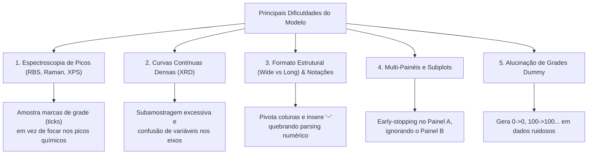

# 🔬 Exemplos Críticos de Falha e Diagnóstico do Modelo

> **Repositório:** [`sci-image-markdown`](file:///home/lucas.ocunha/sci-image-markdown)  
> **Benchmark:** [SciKnowOrg/Sci-ImageMiner](https://huggingface.co/datasets/SciKnowOrg/Sci-ImageMiner) (ICDAR 2026 Task 2)  
> **Modelo Avaliado:** `Qwen2.5-VL-7B-Instruct` com LoRA + ICDAR Metric Loss  
> **Diretório:** [`exemplos_analise_erros/`](file:///home/lucas.ocunha/sci-image-markdown/exemplos_analise_erros)  

Este diretório reúne as figuras científicas reais onde o modelo teve **maior dificuldade, menor score ou maiores desvios numéricos**, acompanhadas das imagens em alta fidelidade, comparação direta com o Ground Truth e diretrizes claras de como redirecionar o modelo.

---

## 📋 Tabela Resumo dos Casos Críticos

| # | Caso / Amostra | Categoria da Falha | ICDAR Score | TEDS | Cell RMSE | Cell Recall |
| :-: | :--- | :--- | :---: | :---: | :---: | :---: |
| **01** | [Amostra 3: Alucinação de Grade Dummy / Linear (QCM Mass vs Time)](./01_alucinacao_grade_dummy_amostra_3.md) | `Alucinação Linear em Dados Não-Lineares` | `0.0789` | `0.0782` | `5.95` | `8.0%` |
| **02** | [Amostra 66: Interpolação de Ticks em Espectro de Picos (RBS)](./02_alucinacao_grade_espectro_rbs_amostra_66.md) | `Falta de Peak-Picking em Espectros Físicos` | `0.3107` | `0.1292` | `37.19` | `50.0%` |
| **03** | [Amostra 176: Leitura de Ticks de Eixo vs. Bandas Físicas (Raman Multi-Amostras)](./03_leitura_ticks_espectro_raman_amostra_176.md) | `Leitura de Ticks em vez de Bandas Espectrais & Erro de Escala` | `0.3476` | `0.4977` | `50.99` | `20.0%` |
| **04** | [Amostra 8: Subamostragem Brutal e Confusão de Eixos (Difratograma XRD)](./04_subamostragem_extrema_eixo_xrd_amostra_8.md) | `Colapso de Resolução e Confusão de Grandeza Cartesiana` | `0.0108` | `0.0143` | `0.00` | `0.7%` |
| **05** | [Amostra 37: Inversão de Formato (Wide vs Long) e Notação Qualitativa com Til (~)](./05_pivotacao_wide_long_til_amostra_37.md) | `Divergência de Formato de Tabela e Incerteza Numérica` | `0.0430` | `0.0518` | `1.79` | `3.5%` |
| **06** | [Amostra 105: Omissão de Múltiplos Painéis por Early Stopping](./06_omissao_multi_painel_amostra_105.md) | `Negligência de Subplots Múltiplos` | `0.3528` | `0.2184` | `20.00` | `50.0%` |
| **07** | [Amostra 266: Conflito Espectro Contínuo vs. Tabela Resumo Embutida](./07_alvo_espectro_vs_tabela_resumo_amostra_266.md) | `Desalinhamento de Foco Visual` | `0.0146` | `0.0292` | `N/A` | `0.0%` |
| **08** | [Amostra 337: Nível de Abstração Espacial vs. Condições Globais](./08_perfil_espacial_vs_condicoes_amostra_337.md) | `Divergência de Semântica e Nível de Agregação` | `0.0695` | `0.1391` | `N/A` | `0.0%` |

---

## 🧭 Os 5 Grandes Padrões de Dificuldade Identificados

---

## 🛠️ Como Direcionar o Modelo: Guia de Ação Prática

Para refinar o modelo e superar essas dificuldades específicas, siga as recomendações abaixo organizadas por nível de intervenção:

### 1. Engenharia e Restrições de Prompt (Impacto Imediato / Zero Treinamento)
* **Proibir Grades Dummy:** Adicionar instrução explícita no `system_prompt`:
  > *"Never output artificial linear or arithmetic dummy sequences (such as 0, 100, 200, 300...) unless they explicitly correspond to labeled measurements in the figure."*
* **Instruir Peak-Picking em Espectros:**
  > *"For continuous spectroscopy plots (RBS, Raman, XPS, FTIR), do not sample regular axis tick intervals. Instead, identify and extract the precise coordinates and labels of local peaks and extrema."*
* **Proibir Símbolos de Aproximação:**
  > *"Output pure numeric floats without approximation characters (e.g. do not write '~10^7' or '~0.5'; write '1e7' or '0.5')."*
* **Exaustão de Multi-Painéis:**
  > *"If the figure contains multiple subplots (panels a, b, c), extract a separate table for EACH panel. Do not stop early."*

### 2. Pós-Processamento e Sanitização Numérica (Ganho de +3 a +5 pp)
* **Stripper de Caracteres Qualitativos:** Antes de enviar a tabela gerada para o cálculo de métricas ou para downstream pipelines, aplicar uma sanitização regex em cada célula:
  - `~0.5` $	o$ `0.5`
  - `~10^6` $	o$ `1000000.0`
  - `87 ± 1.5` $	o$ extrair valor principal `87` e coluna de incerteza `1.5`.

### 3. Refinamento de Dados e Fine-Tuning (Médio Prazo)
* **Aumento de Dados de Espectroscopia:** Enriquecer o conjunto de treino com figuras de espectros com picos identificados (RBS, Raman, XPS).
* **Função de Perda Sensível a Estrutura (ICDAR Loss):** Já implementamos a perda penalizando células e estrutura; aumentar a ponderação de tokens de colunas categóricas (`| Element |`) para desencorajar omissão de legendas.

---

## 📂 Arquivos no Diretório

* [`README.md`](./README.md): Este índice executivo.
* [`01_alucinacao_grade_dummy_amostra_3.md`](./01_alucinacao_grade_dummy_amostra_3.md) + imagem correspondente.
* [`02_alucinacao_grade_espectro_rbs_amostra_66.md`](./02_alucinacao_grade_espectro_rbs_amostra_66.md) + imagem correspondente.
* [`03_leitura_ticks_espectro_raman_amostra_176.md`](./03_leitura_ticks_espectro_raman_amostra_176.md) + imagem correspondente.
* [`04_subamostragem_extrema_eixo_xrd_amostra_8.md`](./04_subamostragem_extrema_eixo_xrd_amostra_8.md) + imagem correspondente.
* [`05_pivotacao_wide_long_til_amostra_37.md`](./05_pivotacao_wide_long_til_amostra_37.md) + imagem correspondente.
* [`06_omissao_multi_painel_amostra_105.md`](./06_omissao_multi_painel_amostra_105.md) + imagem correspondente.
* [`07_alvo_espectro_vs_tabela_resumo_amostra_266.md`](./07_alvo_espectro_vs_tabela_resumo_amostra_266.md) + imagem correspondente.
* [`08_perfil_espacial_vs_condicoes_amostra_337.md`](./08_perfil_espacial_vs_condicoes_amostra_337.md) + imagem correspondente.
